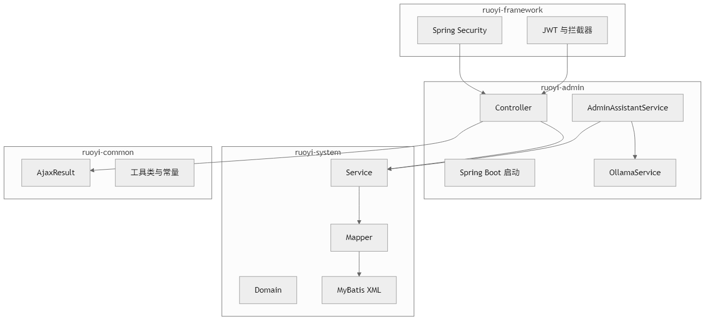
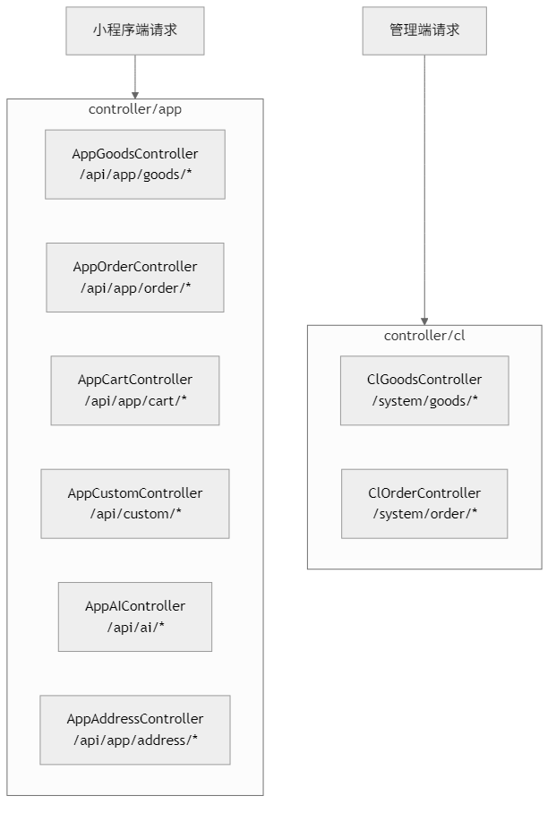
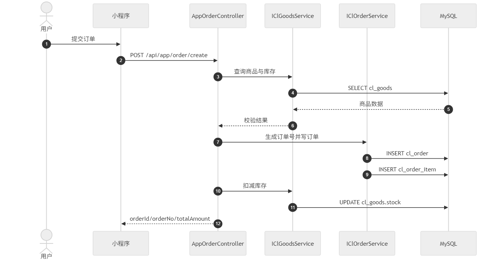
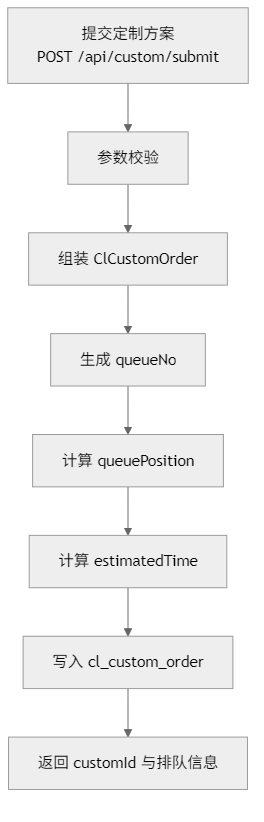
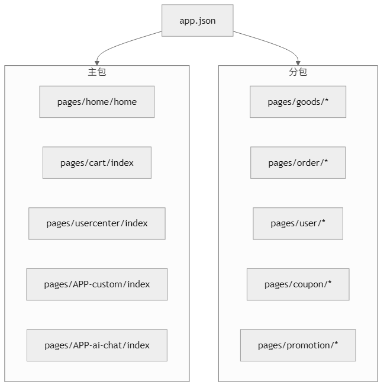
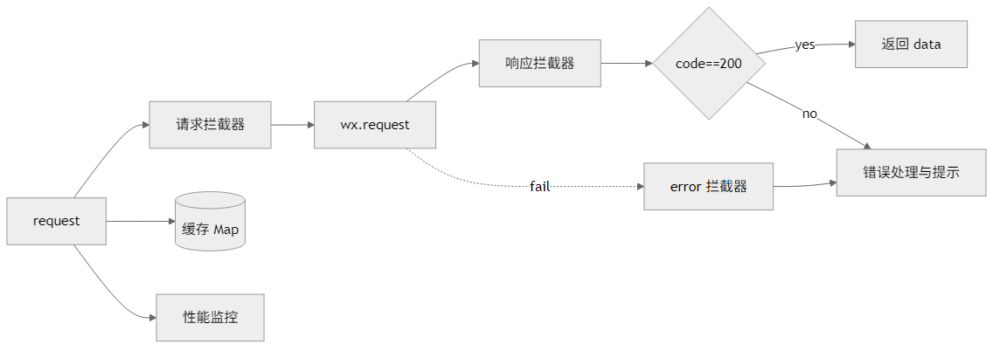

## 后端实现

### 项目结构说明

后端基于若依（RuoYi v3.9.1）框架，采用 Maven 多模块结构。各模块职责如下。

| 模块名称 | 职责说明 | 主要内容 |
| --- | --- | --- |
| ruoyi-admin | 系统主入口模块 | Spring Boot 启动类、Controller、应用配置 |
| ruoyi-system | 业务核心模块 | domain、service、mapper、MyBatis XML |
| ruoyi-framework | 框架模块 | Spring Security、JWT、全局拦截/异常 |
| ruoyi-common | 通用模块 | AjaxResult、工具类、常量、注解 |
| ruoyi-generator | 代码生成模块 | 基于数据表生成代码骨架 |
| ruoyi-quartz | 定时任务模块 | Quartz 任务调度 |

表6-1 项目模块职责表

图6-1 后端模块结构图

### 控制层分层与路由

Controller 按访问端划分为 `controller/app` 与 `controller/cl` 两组。

| 子包路径 | 面向端 | 认证方式 | 代表控制器 | 典型路径 |
| --- | --- | --- | --- | --- |
| controller/app | 小程序 C 端 | `@Anonymous`（部分接口） | AppGoodsController、AppOrderController、AppCartController、AppCustomController、AppAIController、AppAddressController | `/api/app/goods/*`、`/api/app/order/*`、`/api/custom/*`、`/api/ai/*` |
| controller/cl | 管理后台 B 端 | JWT Token + 权限注解 | ClGoodsController、ClOrderController | `/system/goods/*`、`/system/order/*` |
| controller/system | 系统管理 | JWT Token + 权限注解 | 若依原生系统管理控制器 | `/system/*` |

表6-2 控制层分层与路由表

图6-2 控制器路由分层图

### 业务实体实现

当前系统中的核心业务实体如下。

| 实体类名 | 对应数据表 | 说明 |
| --- | --- | --- |
| ClGoods | cl_goods | 商品实体 |
| ClOrder | cl_order | 订单主表实体 |
| ClOrderItem | cl_order_item | 订单明细实体 |
| ClCart | cl_cart | 购物车实体 |
| ClCustomOrder | cl_custom_order | 定制订单实体 |
| ClUserAddress | cl_user_address | 收货地址实体 |
| ClAssistantChat | cl_assistant_chat（逻辑） | 管理端 AI 助手对话记录 |

表6-3 核心业务实体表

> 说明：当前代码中未发现 `ClGoodsExtend` 实体；商品扩展类信息通过 `ClGoods` 字段及定制模块字段承载。

### 商品管理模块实现

（1）控制层（AppGoodsController / ClGoodsController）

- `AppGoodsController`：提供 C 端商品列表与详情接口；列表查询固定追加 `status="0"`，仅返回上架商品。
- `ClGoodsController`：提供 B 端商品管理接口（查询、导出、新增、修改、删除），路径前缀为 `/system/goods`。

（2）业务层（ClGoodsServiceImpl）

`ClGoodsServiceImpl` 实现了标准 CRUD：`selectClGoodsByGoodsId`、`selectClGoodsList`、`insertClGoods`、`updateClGoods`、`deleteClGoodsByGoodsIds`。

（3）数据访问层（ClGoodsMapper）

`selectClGoodsList` 使用 MyBatis 动态 SQL，支持按条件组合过滤。

| 查询条件 | SQL 片段示意 | 说明 |
| --- | --- | --- |
| goodsName 不为空 | `AND goods_name LIKE ...` | 名称模糊查询 |
| goodsType 不为空 | `AND goods_type = ...` | 类型过滤 |
| status 不为空 | `AND status = ...` | 上下架过滤 |

表6-4 商品列表查询条件表

### 订单管理模块实现

（1）控制层（AppOrderController）

`createOrder` 使用 `@Transactional` 保障一致性，并根据 `type` 路由到单商品/多商品两个私有方法。

（2）订单号生成（OrderNoGenerator）

订单号规则：3 位大写字母 + 3 位数字（如 `ABC001`）。数字从 001 到 999 递增，溢出后字母进位；无历史记录时从 `AAA001` 开始。

（3）业务层（IClOrderService / ClOrderServiceImpl）

| 方法名 | 说明 |
| --- | --- |
| insertClOrder | 插入订单主记录 |
| insertClOrderItem / insertClOrderItems | 插入订单明细 |
| updateClOrder | 更新订单（含状态） |
| selectClOrderByOrderId | 按主键查询订单 |
| selectClOrderItemByOrderId | 查询订单明细列表 |
| getMaxOrderNo | 查询最大订单号 |

表6-5 订单业务层核心方法表

（4）关键实现流程

- 创建订单时先校验商品存在、上架状态与库存。
- 写入 `cl_order` 与 `cl_order_item` 后执行库存扣减。
- 任一步失败则事务回滚。

图6-3 订单创建时序图

### 定制服务模块实现

（1）定制提交接口

定制相关由 `AppCustomController` 提供，当前主路径为 `/api/custom/*`，包括：

- `POST /api/custom/submit`：提交定制方案
- `POST /api/custom/save`：保存定制方案
- `GET /api/custom/types`：定制类型
- `GET /api/custom/sizes`：尺寸选项
- `POST /api/custom/calculate-price`：价格计算

（2）排队计算核心逻辑

- 生成排队号（queueNo）
- 计算排队位置（queuePosition）
- 估算完成时间（estimatedTime）
- 写入 `cl_custom_order`（初始状态为待接单）

图6-4 定制提交流程图

（3）定制内容存储

定制内容与规格分别存储在 `custom_content`、`custom_spec` 字段中，采用 JSON 字符串，便于前后端扩展。

### AI 模块实现（当前版本）

当前代码存在两条 AI 能力线：

1. **小程序侧对话能力**：`AppAIController`（`/api/ai/chat`）当前实现为规则分支与模拟回复。
2. **管理端智能助手能力**：`AdminAssistantService + OllamaService`，具备本地 Ollama 调用、问题类型识别、对话落库等能力。

因此本章将 AI 实现按“已落地能力”描述，不再将小程序接口描述为已完整走 `AdminAssistantService -> OllamaService` 的链路。

---

## 前端实现

### 小程序项目结构说明

小程序采用原生框架，使用分包降低首包体积。`app.json` 中主包页面与分包结构如下。

| 目录/文件 | 说明 |
| --- | --- |
| app.js | 小程序入口，初始化全局状态（含 deviceId） |
| app.json | 路由、分包、TabBar、窗口配置 |
| app.wxss | 全局样式 |
| pages/home/home | 首页 |
| pages/cart/index | 购物车 |
| pages/usercenter/index | 个人中心 |
| pages/APP-custom/index | 定制页 |
| pages/APP-ai-chat/index | AI 对话页 |
| pages/goods/* | 商品分包 |
| pages/order/* | 订单分包 |
| pages/user/* | 用户分包 |
| services/ | API 服务层 |
| utils/ | 工具目录 |
| config/ | 环境与业务配置 |

表6-6 小程序目录结构表

图6-6 小程序分包结构图

### 统一请求封装实现

请求封装位于 `services/_utils/request.js`，采用“请求入口 + 拦截器 + 统一错误处理 + 缓存 + 性能监控”的增强结构。

| 功能点 | 实现方式 | 说明 |
| --- | --- | --- |
| 基础地址管理 | `env.config.js` 的 `baseURL` | 开发环境默认 `http://127.0.0.1:8080` |
| 拦截器机制 | request / response / error 拦截器 | 统一处理请求参数与响应格式 |
| 响应解析 | 统一解析 `{code, data, msg}` | `code=200` 返回 data，其余走错误流程 |
| 缓存能力 | `Map` 缓存 | 支持按接口设置缓存时长 |
| 异常处理 | `ErrorHandler` | 统一提示与上报入口 |
| 性能监控 | `PerformanceMonitor` | 记录关键 API 耗时 |

表6-7 请求封装能力表

图6-5 统一请求封装架构图

### API 服务层说明

当前服务层按业务域拆分，除 `services/app/*` 外，还存在独立业务目录（如 `services/custom`、`services/ai`）。

| 文件路径 | 说明 |
| --- | --- |
| services/app/goods.js | 商品接口（C 端） |
| services/app/order.js | 订单接口（C 端） |
| services/app/cart.js | 购物车接口（C 端） |
| services/custom/custom.js | 定制相关接口（`/api/custom/*`） |
| services/ai/ai.js | AI 接口（`/api/ai/*`） |
| services/address/* | 地址相关接口 |

表6-8 API 服务层文件表

### 设备 ID 管理实现

系统采用 `deviceId` 标识匿名用户，流程如下：

1. 小程序启动时调用 `getDeviceId()`。
2. 优先读取本地 `wx.getStorageSync('deviceId')`。
3. 无本地值时按 `device_时间戳_随机串` 生成。
4. 通过 `wx.setStorageSync` 持久化，并挂载到 `app.globalData.deviceId`。

### 核心页面实现

（1）首页（`pages/home/home`）

| 实现要点 | 说明 |
| --- | --- |
| 并发加载 | `Promise.all` 并发请求首页数据 |
| 下拉刷新 | `onPullDownRefresh` 触发重新加载 |
| 上拉加载 | `onReachBottom` 分页追加 |
| 分类筛选 | 分类标签切换驱动列表过滤 |
| 骨架屏 | 加载期展示占位内容 |

（2）购物车页（`pages/cart/index`）

| 实现要点 | 说明 |
| --- | --- |
| `onShow` 刷新 | 页面回到前台时主动同步购物车 |
| 选中态管理 | `selectedIds` 维护勾选状态 |
| 实时金额计算 | 按勾选项计算合计金额 |
| 数量修改 | 本地更新与接口更新结合 |

（3）定制页（`pages/APP-custom/index`）

| 实现要点 | 说明 |
| --- | --- |
| 动态表单 | 材质/尺寸/印刷方式等单选项 |
| 实时价格计算 | 选项变化触发价格重算 |
| 提交校验 | 必填项未填时给出提示 |
| 排队信息展示 | 成功后显示 queueNo/queuePosition/estimatedTime |

（4）AI 对话页（`pages/APP-ai-chat/index`）

| 实现要点 | 说明 |
| --- | --- |
| 消息列表状态 | 维护 user/assistant 消息数组 |
| 自动滚动 | 新消息到达后滚动到底部 |
| 发送态控制 | 发送中禁用重复提交 |
| 推荐商品卡片 | 回复中展示商品卡片并可跳转 |

---

## 系统界面

### 管理后台界面说明

管理后台基于若依 Vue2 模板，采用左侧菜单 + 顶部导航布局。关键页面如下：

- 商品管理页：查询区、列表区、新增/编辑弹窗、分页区。
- 订单管理页：多条件筛选、订单详情抽屉、状态更新弹窗。

### 小程序前端界面说明

小程序界面基于 TDesign 组件体系，关键页面包括：首页、商品详情、购物车、定制、AI 对话。建议正文最终稿补充真实运行截图（每页至少 1 张）以增强“实现”章节证明力。
