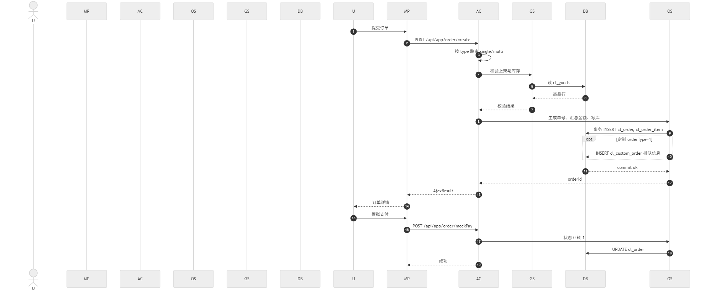
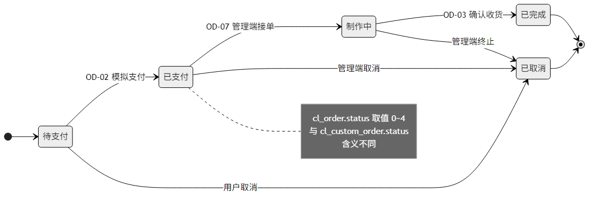
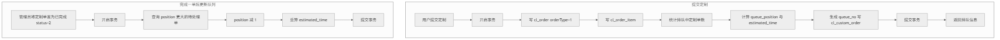
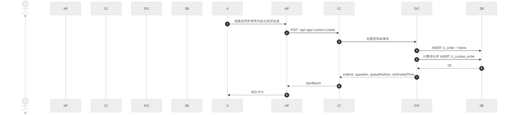
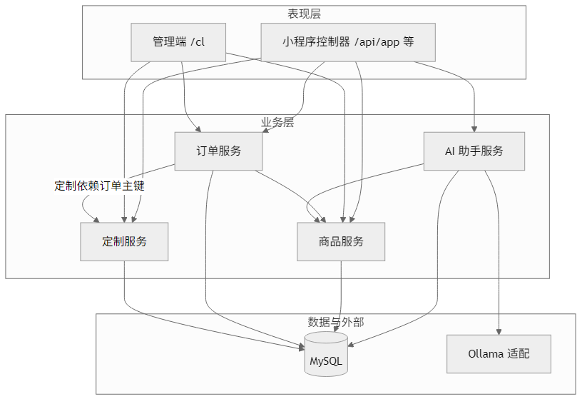
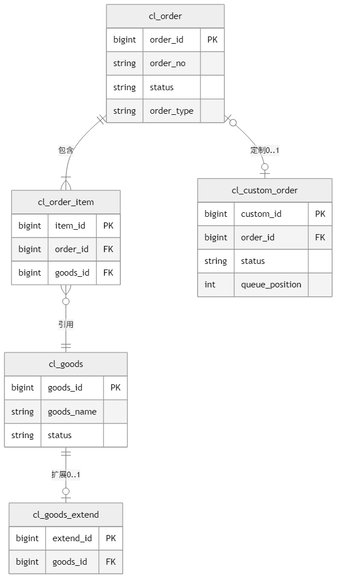

# 详细设计

本章对系统各核心功能模块进行详细设计，包括接口设计、业务流程设计和数据模型设计三个维度，为后续系统实现提供设计依据。本章插图编号为**图 5-1～图 5-9**，源文件为同目录下 `图片/*.mmd`（Mermaid），导出 PNG 后插入 Word 正文时请将图题按学校格式统一（如「图 5-x 图名」）。

## 全局设计约定

### 统一响应格式与典型错误码

C 端与 B 端 REST 接口在控制器层统一封装为若依 **AjaxResult**（或等价结构），典型字段：`code`（HTTP 层仍多为 200，业务成功与否看 `code` 与 `msg`）、`msg`、`data`。成功时 `code` 取 200，`data` 为业务载荷。常见失败包括：参数校验失败、商品不存在或已下架、库存不足、订单状态不允许当前操作等，均在 `msg` 中返回可读说明。管理端未携带有效 Token 或权限不足时，由 Spring Security 与若依权限注解拦截，返回未授权或禁止访问类响应。

### 鉴权、匿名访问与分页

毕业设计演示环境中，小程序侧部分接口标注为**匿名**，通过 **`deviceId`** 关联同一终端产生的订单与对话记录；正式运营可接入微信登录以 `openid` 绑定或替代设备标识。B 端列表类接口（如 **GD-03、OD-06、CS-03**）遵循若依分页约定，支持 **`pageNum`、`pageSize`** 及常用筛选字段；**AI-02** 历史查询同样支持分页（如 `pageNum`、`pageSize` 与 `deviceId` 条件）。

### 订单状态字段与定制单状态字段

**`cl_order.status`** 表示订单支付与履约主线（0 待支付、1 已支付、2 制作中、3 已完成、4 已取消）。**`cl_custom_order.status`** 仅描述定制车间侧的排队与制作进度（0 待接单、1 制作中、2 已完成）。二者编码含义不同，文档与实现中须区分表名与字段语义，避免将「订单已支付」与「定制待接单」混为一谈。

### 定制订单创建的两种设计入口

- **路径一（定制页一键提交）**：调用 **CS-01**，在单笔数据库事务中依次写入 **`cl_order`（`orderType=1`）**、**`cl_order_item`** 与 **`cl_custom_order`**（含排队号、排队位置、预计完成时间等）。
- **路径二（通用下单聚合）**：调用 **OD-01**，当业务判定为定制订单时，在同一事务内除订单主表与明细外，**追加写入 `cl_custom_order`** 及相关排队信息。

两条路径在设计上允许并存，但实现层须约定小程序**实际主调入口**，避免同一笔业务重复调用导致重复插入。

### 设计路径与当前工程实现对照

概要设计将小程序后端接口逻辑分组在 **`/api/app/*`** 下叙述。当前 **RuoYi-Vue** 工程中实际控制器前缀包括：`/api/app/goods`、`/api/app/order`；定制相关为 **`/api/custom/*`**（例如提交定制方案 **`POST /api/custom/submit`**）；AI 相关为 **`/api/ai/*`**（例如 **`POST /api/ai/chat`**）。文档表格中仍保留 **CS-01、AI-01** 等逻辑路径写法，便于与概要设计对照；落地时以代码 `@RequestMapping` 为准，或通过网关统一前缀映射。

---

## 商品管理模块

### 模块概述

商品管理模块是系统的核心基础模块，负责春联商品信息的全生命周期管理。该模块向上为小程序端和管理后台提供商品数据服务，向下与数据库进行持久化交互。模块采用标准三层架构（Controller → Service → Mapper），各层通过接口解耦，职责边界清晰。

模块对外提供两套接口：面向小程序端的只读接口（匿名访问，仅返回上架商品）和面向管理后台的完整增删改查接口（需要管理员权限）。商品分为普通商品（goodsType=0）和定制商品（goodsType=1）两种类型，定制商品额外关联材质、尺寸等扩展信息。

### 接口设计

商品管理模块对外暴露的主要接口如下表所示：

| **接口编号** | **接口名称** | **请求方式** | **接口路径** | **访问权限** | **功能描述** |
| --- | --- | --- | --- | --- | --- |
| GD-01 | 获取商品列表（C端） | GET | /api/app/goods/list | 匿名  | 查询上架商品列表，支持按名称模糊查询、按类型筛选 |
| GD-02 | 获取商品详情（C端） | GET | /api/app/goods/{goodsId} | 匿名  | 根据商品ID查询单个商品的完整信息 |
| GD-03 | 查询商品列表（B端） | GET | /cl/goods/list | 管理员 | 分页查询所有商品，支持多条件组合筛选 |
| GD-04 | 新增商品 | POST | /cl/goods | 管理员 | 新增商品基本信息及扩展信息 |
| GD-05 | 修改商品 | PUT | /cl/goods | 管理员 | 修改商品信息，同步更新扩展信息 |
| GD-06 | 删除商品 | DELETE | /cl/goods/{goodsIds} | 管理员 | 根据商品ID批量删除商品 |
| GD-07 | 修改上架状态 | PUT | /cl/goods/changeStatus | 管理员 | 更新商品的上架/下架状态 |

**B 端列表分页（GD-03）**：请求中携带若依标准分页参数 **`pageNum`（页码）、`pageSize`（每页条数）**，可选 **`goodsName`、`goodsType`、`status`** 等筛选条件；响应 `rows` 为当前页数据，`total` 为总记录数（与具体若依版本字段名保持一致即可）。

接口GD-01请求参数说明：

| **参数名** | **类型** | **是否必填** | **说明** |
| --- | --- | --- | --- |
| goodsName | String | 否   | 商品名称，支持模糊匹配 |
| goodsType | String | 否   | 商品类型，0为普通商品，1为定制商品 |

接口GD-01响应数据说明：

| **字段名** | **类型** | **说明** |
| --- | --- | --- |
| code | Integer | 响应状态码，200表示成功 |
| data | Array | 商品列表数组 |
| data\[\].goodsId | Long | 商品ID |
| data\[\].goodsName | String | 商品名称 |
| data\[\].goodsPrice | BigDecimal | 商品价格 |
| data\[\].stock | Integer | 库存数量 |
| data\[\].coverImage | String | 封面图片绝对URL |
| data\[\].rating | BigDecimal | 商品评分 |
| msg | String | 响应消息 |

### 业务流程设计

商品列表查询流程如下：

（1）小程序发起GET请求，携带可选查询参数（goodsName、goodsType）。

（2）AppGoodsController接收请求，构建ClGoods查询对象，强制设置status="0"，确保只返回上架商品。

（3）调用IClGoodsService.selectClGoodsList()执行业务查询，MyBatis根据传入条件动态拼接WHERE子句。

（4）查询结果逐层返回，Controller封装为AjaxResult标准格式响应给小程序。

（5）小程序端request工具解析响应，调用toAbsoluteUrl()将图片相对路径转换为绝对URL后渲染页面。

商品新增流程如下：

（1）管理员填写商品信息，提交POST请求至/cl/goods。

（2）系统校验商品名称非空、价格非负、库存非负等基本合法性，不合法请求在进入业务层前被拦截。

（3）向cl_goods表插入商品主记录，获取数据库自增的goodsId。

（4）若goodsType=1（定制商品），在同一事务中同步向cl_goods_extend表插入扩展信息记录。

（5）返回操作结果，管理后台刷新商品列表。

### 数据模型设计

商品实体（ClGoods）属性说明：

| **属性名** | **类型** | **对应字段** | **说明** |
| --- | --- | --- | --- |
| goodsId | Long | goods_id | 商品唯一标识，主键 |
| goodsName | String | goods_name | 商品名称，不可为空 |
| goodsType | String | goods_type | 商品类型，"0"普通，"1"定制 |
| goodsPrice | BigDecimal | goods_price | 商品售价，精确到分 |
| stock | Integer | stock | 当前库存数量 |
| coverImage | String | cover_image | 封面图片存储路径 |
| images | String | images | 多图路径，逗号分隔 |
| description | String | description | 商品详情描述 |
| rating | BigDecimal | rating | 综合评分，范围0.00~5.00 |
| status | String | status | 上架状态，"0"上架，"1"下架 |
| sortOrder | Integer | sort_order | 排序权重，值越小越靠前 |

商品扩展实体（ClGoodsExtend）属性说明：

| **属性名** | **类型** | **对应字段** | **说明** |
| --- | --- | --- | --- |
| extendId | Long | extend_id | 扩展记录主键 |
| goodsId | Long | goods_id | 关联商品ID，唯一外键 |
| material | String | material | 材质描述，如宣纸、金纸 |
| length | BigDecimal | length | 商品长度，单位cm |
| width | BigDecimal | width | 商品宽度，单位cm |
| size | String | size | 尺寸规格描述，如大号/中号/小号 |

### 时序图与插图

**图 5-1**　商品管理模块 C 端商品列表查询时序图

**图 5-2**　商品管理模块 B 端商品新增时序图（含定制扩展同事务）

图源稿：`图片/fig5-01-goods-c-list.mmd`、`图片/fig5-02-goods-b-add.mmd`。

---

## 订单管理模块

### 模块概述

订单管理模块负责处理用户订单的全生命周期，包括订单创建、支付确认、状态流转和信息查询等功能。模块采用状态机模式管理订单状态，通过数据库事务保证订单数据的一致性。

订单分为两种类型：普通订单（orderType=0）和定制订单（orderType=1）。普通订单创建后直接进入待支付状态；定制订单创建后除进入待支付状态外，还会同步创建定制订单记录并加入排队系统。订单状态共5种，状态编码及流转规则如下表所示。**管理端手工迁移订单主状态**由 **OD-07** 等接口在通过校验后更新 **`cl_order.status`**；小程序模拟支付、确认收货等由 **OD-02、OD-03** 触发。

| **状态编码** | **状态名称** | **可流转至** | **触发条件** |
| --- | --- | --- | --- |
| 0   | 待支付 | 1（已支付）、4（已取消） | 用户完成支付 / 用户主动取消 |
| 1   | 已支付 | 2（制作中）、4（已取消） | 管理员接单 / 管理员取消 |
| 2   | 制作中 | 3（已完成）、4（已取消） | 管理员完成制作 / 管理员取消 |
| 3   | 已完成 | —   | 终态，不可再流转 |
| 4   | 已取消 | —   | 终态，不可再流转 |

### 接口设计

订单管理模块对外暴露的主要接口如下表所示：

| **接口编号** | **接口名称** | **请求方式** | **接口路径** | **访问权限** | **功能描述** |
| --- | --- | --- | --- | --- | --- |
| OD-01 | 创建订单 | POST | /api/app/order/create | 匿名  | 创建普通订单或定制订单，支持单商品和多商品 |
| OD-02 | 模拟支付 | POST | /api/app/order/mockPay | 匿名  | 将待支付订单状态更新为已支付 |
| OD-03 | 确认收货 | POST | /api/app/order/confirmReceive | 匿名  | 将制作中订单状态更新为已完成 |
| OD-04 | 查询订单列表 | GET | /api/app/order/list | 匿名  | 按设备ID或收货电话查询订单列表 |
| OD-05 | 查询订单详情 | GET | /api/app/order/{orderId} | 匿名  | 根据订单ID查询订单完整信息及明细 |
| OD-06 | 管理端查询订单 | GET | /cl/order/list | 管理员 | 分页查询所有订单，支持多条件筛选 |
| OD-07 | 管理端更新状态 | PUT | /cl/order/updateStatus | 管理员 | 手动更新订单状态 |

**B 端订单列表（OD-06）**：携带 **`pageNum`、`pageSize`** 及可选筛选字段（如订单号、状态、时间范围等），与若依 `TableDataInfo` 约定一致。

接口OD-01请求体参数说明：

| 参数名 | 类型  | 是否必填 | 说明  |
| --- | --- | --- | --- |
| type | String | 是   | 订单类型，"single"单商品，"multi"多商品 |
| deviceId | String | 是   | 设备ID，用于标识用户 |
| goodsId | Long | type=single时必填 | 商品ID |
| quantity | Integer | type=single时必填 | 购买数量 |
| items | Array | type=multi时必填 | 商品列表，每项含goodsId和quantity |
| receiverName | String | 是   | 收货人姓名 |
| receiverPhone | String | 是   | 收货人电话 |
| receiverAddress | String | 是   | 收货地址 |

### 业务流程设计

订单创建流程如下：

（1）小程序发起POST请求，携带订单信息请求体。

（2）AppOrderController根据type字段路由至单商品或多商品创建逻辑。

（3）遍历商品列表，逐一校验商品是否存在、是否上架、库存是否充足，任一校验失败则返回错误信息并终止流程。

（4）调用OrderNoGenerator.generateOrderNo()生成唯一订单号。订单号由3位大写字母和3位数字组成（如ABC001），数字部分从001递增至999，达到999后字母部分按字典序进位（AAA→AAB→...→AAZ→ABA→...）。

（5）计算订单总金额，即各商品单价与购买数量乘积的累加和。

（6）在数据库事务中依次执行：向cl_order表插入订单主记录；向cl_order_item表批量插入订单明细记录，明细中保存商品名称和价格的快照，防止商品信息变更影响历史订单。任一步失败则整单回滚，不产生孤立明细。

（7）若为定制订单，在同一事务中额外执行：查询当前排队总数，计算排队位置；计算预计完成时间；生成排队号；向cl_custom_order表插入定制订单记录。

（8）事务提交成功后，返回新创建的orderId给小程序，小程序跳转至订单详情页展示订单信息。

### 数据模型设计

订单实体（ClOrder）属性说明：

| 属性名 | 类型  | 对应字段 | 说明  |
| --- | --- | --- | --- |
| orderId | Long | order_id | 订单唯一标识，主键 |
| orderNo | String | order_no | 业务订单号，唯一索引 |
| deviceId | String | device_id | 下单设备ID |
| orderType | String | order_type | "0"普通订单，"1"定制订单 |
| totalAmount | BigDecimal | total_amount | 订单总金额 |
| status | String | status | 订单状态，0~4 |
| receiverName | String | receiver_name | 收货人姓名 |
| receiverPhone | String | receiver_phone | 收货人联系电话 |
| receiverAddress | String | receiver_address | 完整收货地址 |

订单明细实体（ClOrderItem）属性说明：

| 属性名 | 类型  | 对应字段 | 说明  |
| --- | --- | --- | --- |
| itemId | Long | item_id | 明细唯一标识，主键 |
| orderId | Long | order_id | 所属订单ID，外键 |
| goodsId | Long | goods_id | 商品ID（仅作关联参考） |
| goodsName | String | goods_name | 下单时商品名称快照 |
| goodsPrice | BigDecimal | goods_price | 下单时商品价格快照 |
| quantity | Integer | quantity | 购买数量 |

### 时序图与插图

**图 5-3**　订单管理模块 C 端创建订单与模拟支付时序图

**图 5-4**　订单主表 cl_order 状态机图（与 OD-02、OD-03、OD-07 等触发对应）

图源稿：`图片/fig5-03-order-create-pay.mmd`、`图片/fig5-04-order-state.mmd`。

---

## 定制服务模块

### 模块概述

定制服务模块是本系统的特色功能模块，为用户提供春联个性化定制服务。模块包含三个核心子功能：定制选项管理、智能排队系统和预计时间计算。该模块与订单管理模块紧密协作，定制订单的创建依托订单管理模块的事务机制保证数据一致性。

系统支持多种定制选项，包括材质（宣纸、金纸、红纸等）、尺寸（大号、中号、小号等）、印刷方式（手写、印刷等）。定制内容以JSON格式存储在定制订单表中，支持灵活的选项组合扩展。

### 接口设计

定制服务模块对外暴露的主要接口如下表所示（逻辑路径；**当前工程**中定制提交见 **`POST /api/custom/submit`** 等，参见「全局设计约定」工程对照说明）。

| 接口编号 | 接口名称 | 请求方式 | 接口路径 | 访问权限 | 功能描述 |
| --- | --- | --- | --- | --- | --- |
| CS-01 | 提交定制订单 | POST | /api/app/custom/create | 匿名  | 创建定制订单，自动计算排队信息 |
| CS-02 | 查询排队信息 | GET | /api/app/custom/queue/{orderId} | 匿名  | 查询指定订单的当前排队位置和预计完成时间 |
| CS-03 | 查询定制订单列表 | GET | /cl/custom/list | 管理员 | 分页查询定制订单列表，支持按状态筛选 |
| CS-04 | 更新定制状态 | PUT | /cl/custom/updateStatus | 管理员 | 更新定制订单状态，触发排队位置重新计算 |

**B 端定制列表（CS-03）**：携带 **`pageNum`、`pageSize`** 及 **`status`** 等筛选条件。

### 智能排队系统设计

本节所述 **`status`** 均指 **`cl_custom_order.status`**（0 待接单、1 制作中、2 已完成），**不得**与 **`cl_order.status`** 混淆，参见全局约定。

排队系统采用先进先出（FIFO）原则，核心算法如下。

排队位置计算：新订单的排队位置等于当前处于"待接单"（status=0）或"制作中"（status=1）状态的定制订单总数加1，即：排队位置 = COUNT(status IN (0, 1)) + 1。

预计完成时间计算：预计完成时间 = 当前时间 + 排队位置 × 平均处理时长。平均处理时长默认设定为30分钟/单，可由管理员在系统参数中动态调整。

排队号生成规则：排队号格式为Q + yyyyMMdd（8位日期）+ 3位序号，例如Q20260201001。序号在每日内从001开始递增，跨日后重置。

排队位置动态更新机制：当管理员将某定制订单状态更新为"已完成"（status=2）时，系统自动触发以下更新逻辑：

（1）查询所有排队位置大于当前完成订单排队位置的待处理定制订单。

（2）将上述订单的queue_position字段值减1。

（3）根据新的排队位置重新计算estimated_time字段。

（4）上述操作在同一数据库事务中执行，保证排队数据的一致性。

### 业务流程设计

定制订单提交流程如下：

（1）用户在小程序定制页面选择定制选项（材质、尺寸、印刷方式），输入定制文字内容，填写收货信息，点击提交。

（2）小程序将定制选项序列化为JSON格式，连同收货信息一起发送POST请求至设计路径 `/api/app/custom/create`（或工程实际 `/api/custom/submit`）。

（3）AppCustomController接收请求，调用定制服务创建逻辑。

（4）系统在数据库事务中依次执行：创建订单主记录（orderType=1）；创建订单明细记录；计算排队位置和预计完成时间；生成排队号；创建定制订单记录。

（5）事务提交成功后，返回orderId、排队号（queueNo）、排队位置（queuePosition）和预计完成时间（estimatedTime）。

（6）小程序展示排队信息卡片，告知用户当前排队状态。

### 数据模型设计

定制订单实体（ClCustomOrder）属性说明：

| 属性名 | 类型  | 对应字段 | 说明  |
| --- | --- | --- | --- |
| customId | Long | custom_id | 定制记录唯一标识，主键 |
| orderId | Long | order_id | 关联订单ID，外键 |
| queueNo | String | queue_no | 排队号，格式Q+日期+序号 |
| queuePosition | Integer | queue_position | 当前排队位置，动态更新 |
| estimatedTime | Date | estimated_time | 预计完成时间，动态更新 |
| customContent | String | custom_content | 定制内容，JSON格式存储 |
| status | String | status | "0"待接单，"1"制作中，"2"已完成 |

定制内容JSON结构说明：

| 字段名 | 类型  | 说明  |
| --- | --- | --- |
| material | String | 材质，如"宣纸"、"金纸"、"红纸" |
| size | String | 尺寸规格，如"大号"、"中号"、"小号" |
| printingType | String | 印刷方式，如"手写"、"印刷" |
| content | String | 定制文字内容 |
| specialRequirements | String | 特殊要求（可选） |

### 时序图与插图

**图 5-5**　定制服务模块排队与队列位置更新活动图

**图 5-6**　定制服务模块定制订单创建时序图（路径一）

图源稿：`图片/fig5-05-custom-queue.mmd`、`图片/fig5-06-custom-create.mmd`。

---

## AI对话模块

### 模块概述

AI对话模块是本系统的智能化特色模块，通过集成本地部署的Ollama大语言模型服务，为用户提供基于自然语言的春联推荐和购物引导功能。模块由AppAIController（接口层）、AdminAssistantService（业务层）和OllamaService（AI服务适配层）三个核心组件构成，各组件职责单一，通过接口调用协作完成对话处理。

模块的核心设计思路是"数据注入式推荐"：在每次对话前，系统将当前上架的商品数据动态注入AI的系统提示词中，使AI能够基于真实商品库进行推荐，从根本上避免AI推荐不存在商品的问题。

### 接口设计

AI对话模块对外暴露的主要接口如下表所示（逻辑路径；**当前工程**示例为 **`POST /api/ai/chat`**，参见全局约定）。

| 接口编号 | 接口名称 | 请求方式 | 接口路径 | 访问权限 | 功能描述 |
| --- | --- | --- | --- | --- | --- |
| AI-01 | 发起对话 | POST | /api/app/ai/chat | 匿名  | 接收用户问题，调用AI模型生成回答并返回推荐商品 |
| AI-02 | 查询历史记录 | GET | /api/app/ai/history | 匿名  | 按设备ID分页查询历史对话记录 |

接口AI-01请求体参数说明：

| 参数名 | 类型  | 是否必填 | 说明  |
| --- | --- | --- | --- |
| deviceId | String | 是   | 设备ID，用于关联对话记录 |
| question | String | 是   | 用户输入的问题内容 |

接口AI-01响应数据说明：

| 字段名 | 类型  | 说明  |
| --- | --- | --- |
| answer | String | AI生成的回答文本 |
| recommendedGoods | Array | 推荐商品列表 |
| recommendedGoods\[\].goodsId | Long | 推荐商品ID |
| recommendedGoods\[\].goodsName | String | 推荐商品名称 |
| recommendedGoods\[\].goodsPrice | BigDecimal | 推荐商品价格 |
| recommendedGoods\[\].coverImage | String | 推荐商品封面图片URL |

### 业务流程设计

AI对话处理流程如下：

（1）小程序发起POST请求，携带deviceId和question。

（2）AppAIController接收请求，调用AdminAssistantService.chat()方法。

（3）AdminAssistantService从数据库查询当前所有上架商品，提取goodsId、goodsName、goodsType、goodsPrice等关键字段，拼接为结构化文本作为商品数据摘要。

（4）构建系统提示词（System Prompt），内容包括角色定义（"你是一个专业的春联销售助手"）、商品数据摘要和推荐规则（"只推荐以下商品列表中存在的商品"），将提示词和用户问题组装为Ollama API请求体。

（5）OllamaService通过HTTP调用本地Ollama服务（默认地址http://localhost:11434），获取AI生成的回答文本。应对调用设置**合理超时**（如 30～120 秒可配置）；超时或下游不可用时，**降级**为固定提示文案，`recommendedGoods` 可为空列表，避免接口长时间挂起。

（6）AdminAssistantService解析AI回答，提取其中提及的商品名称关键词，与商品数据库进行模糊匹配，获取对应的商品ID列表。

（7）将本次对话记录（deviceId、question、answer、recommendedGoods）保存至cl_ai_chat_log表。

（8）将answer和推荐商品完整信息返回给小程序，小程序渲染AI回复气泡，若存在推荐商品则在气泡下方展示商品卡片列表。

### 数据模型设计

AI对话记录实体（ClAiChatLog）属性说明：

| 属性名 | 类型  | 对应字段 | 说明  |
| --- | --- | --- | --- |
| chatId | Long | chat_id | 对话记录唯一标识，主键 |
| deviceId | String | device_id | 发起对话的设备ID |
| question | String | question | 用户提问内容 |
| answer | String | answer | AI生成的回答内容 |
| recommendedGoods | String | recommended_goods | 推荐商品ID列表，JSON数组格式 |
| createTime | Date | create_time | 对话发生时间 |

### 时序图与插图

**图 5-7**　AI 对话模块处理时序图（含超时降级分支）

图源稿：`图片/fig5-07-ai-chat.mmd`。

---

## 跨模块视图

**图 5-8**　核心功能模块依赖关系图（表现层、业务层与外部依赖）

**图 5-9**　核心业务表逻辑 E-R 简图（物理表以 `cl_*` 为准）

图源稿：`图片/fig5-08-module-deps.mmd`、`图片/fig5-09-core-er.mmd`。
