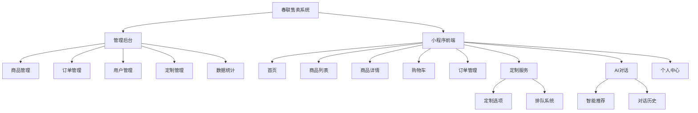
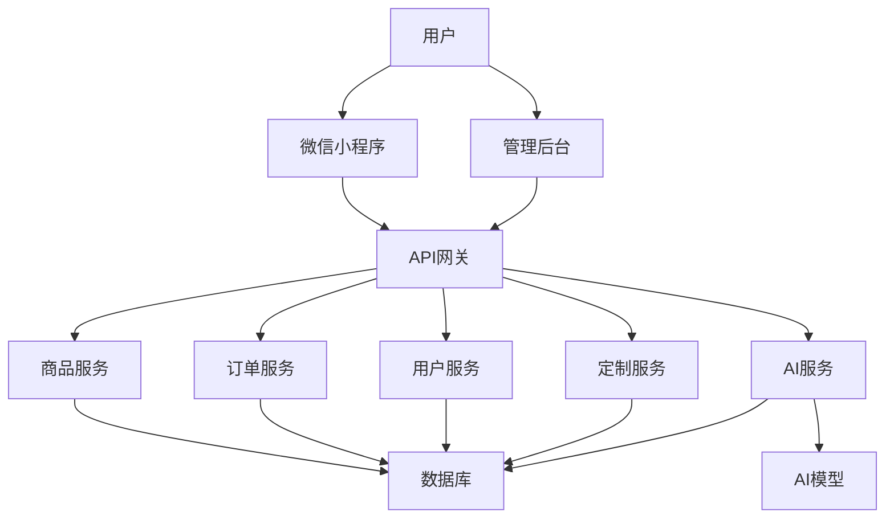
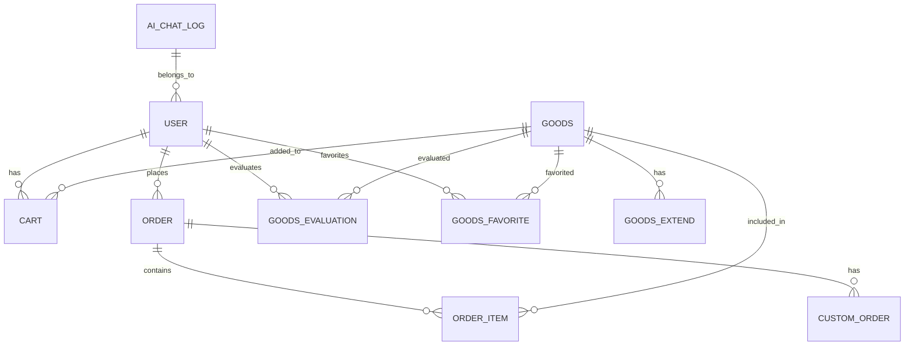
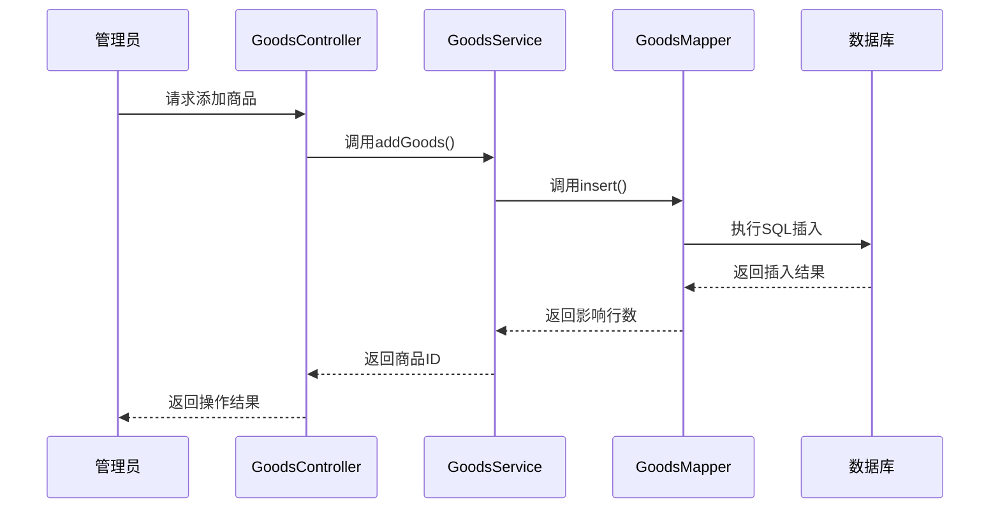
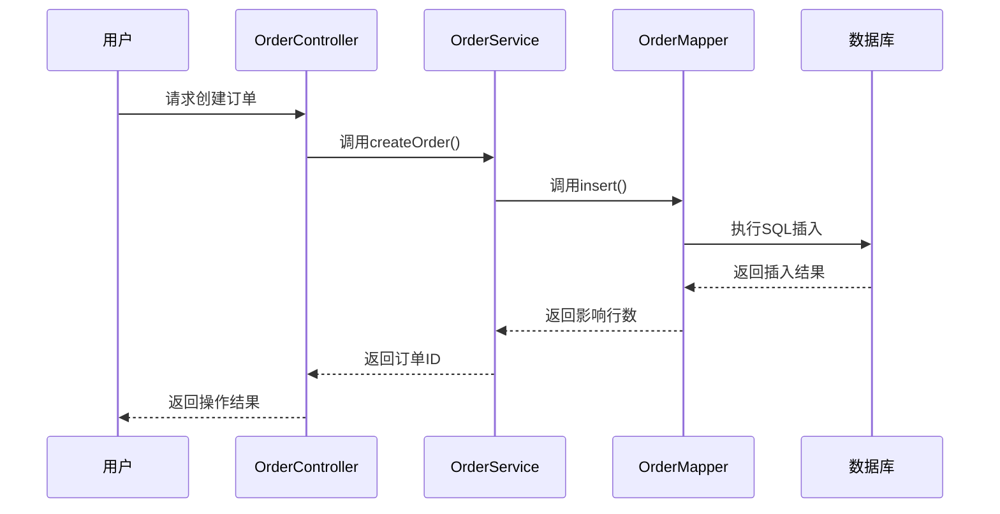
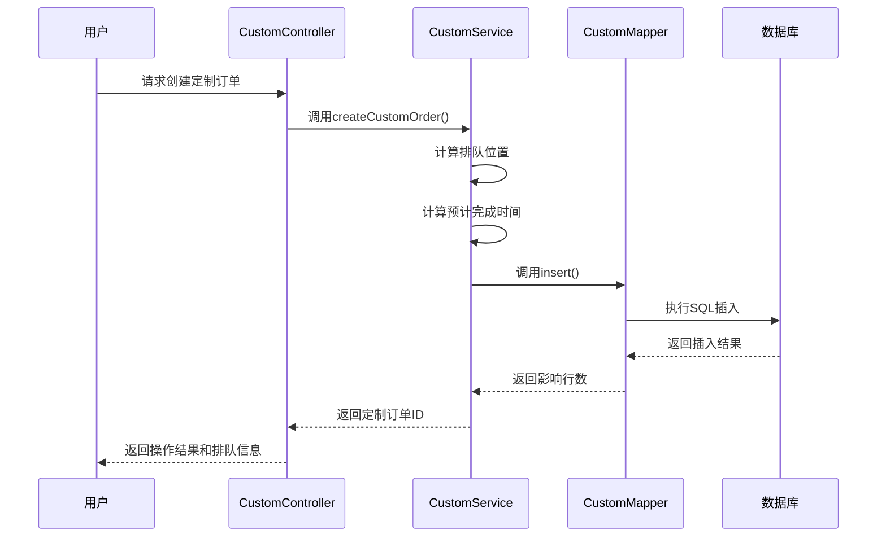
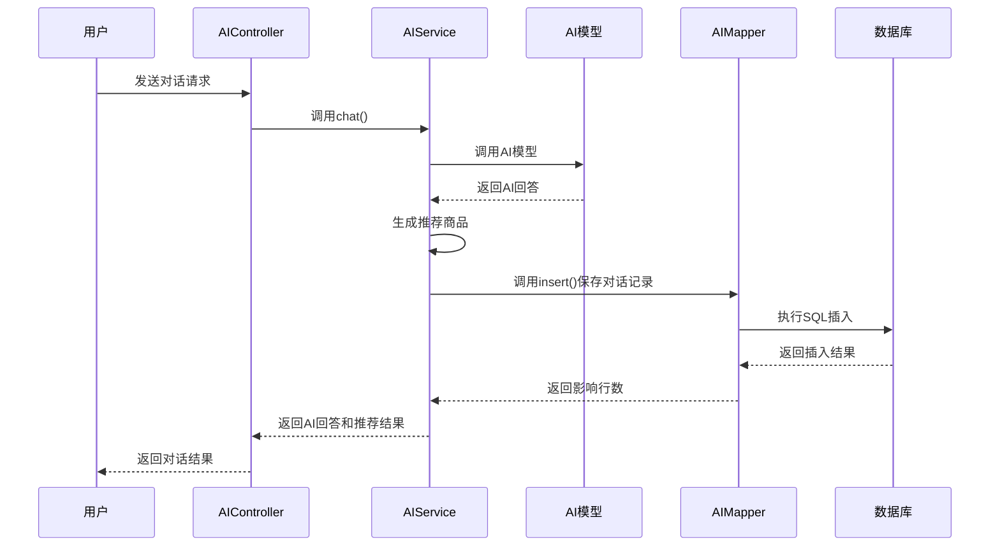

# 春联售卖系统毕业设计说明书

**作者**：[作者姓名]
**指导教师**：[指导教师姓名]
**完成日期**：2026年3月

## 设计总说明

### 1. 设计背景

随着传统文化的复兴和人们对节日氛围的重视，春联作为中国传统节日文化的重要组成部分，市场需求逐年增长。然而，传统的春联销售模式存在诸多问题，如：线下店铺覆盖范围有限、定制服务流程繁琐、排队等待时间长、缺乏个性化推荐等。为了解决这些问题，开发一套集线上销售、定制服务、智能推荐于一体的春联售卖系统显得尤为必要。

### 2. 设计目标与核心功能

本设计旨在开发一套完整的春联售卖系统，包括后台管理系统和微信小程序前端。系统采用前后端分离架构，后端基于Spring Boot和MyBatis实现，前端分为管理后台（Vue2 + ElementUI）和微信小程序（TDesign组件库）。核心功能包括：

- **商品管理**：支持普通春联和定制春联的管理，包括商品信息的增删改查、库存管理等。
- **订单管理**：支持普通订单和定制订单的处理，实现订单状态的流转跟踪。
- **定制服务**：提供春联定制功能，支持用户选择材质、尺寸、印刷方式等定制选项。
- **排队系统**：针对定制订单实现智能排队功能，计算预计完成时间，提高用户体验。
- **AI对话推荐**：集成AI对话功能，根据用户需求推荐合适的春联产品。
- **购物车管理**：支持商品的添加、修改、删除等操作，实现批量结算。

### 3. 技术亮点

- **前后端分离架构**：采用Spring Boot + Vue2 + 微信小程序的前后端分离架构，提高系统的可维护性和扩展性。
- **智能排队系统**：基于订单数量和处理时间，智能计算定制订单的排队位置和预计完成时间。
- **AI智能推荐**：集成AI对话功能，根据用户需求和历史数据推荐个性化春联产品。
- **响应式设计**：管理后台采用ElementUI实现响应式布局，小程序前端适配不同屏幕尺寸。
- **数据安全**：采用Spring Security实现权限管理，确保系统数据安全。

### 4. 本文主要内容

本文详细介绍春联售卖系统的设计与实现过程，包括系统需求分析、架构设计、数据库设计、功能模块实现等。全文共分为八章，第一章为系统绪论，介绍项目背景和意义；第二章为相关技术介绍，阐述系统使用的技术栈；第三章为需求分析，详细分析系统的功能需求和非功能需求；第四章为概要设计，描述系统的总体架构和模块划分；第五章为详细设计，详细介绍各模块的实现细节；第六章为系统实现，展示系统的具体实现和界面效果；第七章为系统测试，验证系统的功能和性能；第八章为总结和展望，总结系统的完成情况并提出未来改进方向。

## 一、系统绪论

### 1.1 背景和意义

春联作为中国传统节日文化的重要载体，承载着人们对新年的美好祝愿和期盼。随着人们生活水平的提高和对传统文化的重视，春联市场需求持续增长。然而，传统的春联销售模式存在以下问题：

- **销售渠道单一**：主要依赖线下实体店，覆盖范围有限，无法满足消费者的便捷购物需求。
- **定制服务不便**：传统定制春联需要到店咨询、现场沟通，流程繁琐，等待时间长。
- **缺乏个性化推荐**：消费者难以快速找到符合自己需求的春联产品，尤其是定制需求。
- **订单管理混乱**：传统手工记录订单方式容易出错，订单状态不透明，影响用户体验。

基于以上问题，开发一套集线上销售、定制服务、智能推荐于一体的春联售卖系统具有重要意义：

- **拓展销售渠道**：通过微信小程序实现线上销售，覆盖更广泛的用户群体。
- **提升定制服务体验**：在线定制功能让用户可以随时随地提交定制需求，智能排队系统提高服务效率。
- **个性化推荐**：AI对话功能根据用户需求推荐合适的春联产品，提升用户满意度。
- **规范化订单管理**：系统自动记录和跟踪订单状态，提高管理效率和透明度。

### 1.2 相关研究

目前，市场上已有一些电商系统和定制服务平台，但针对春联这一特定领域的专业系统还相对较少。相关研究主要集中在以下几个方面：

- **电商系统**：如淘宝、京东等大型电商平台，提供了成熟的商品管理、订单处理和支付功能，但缺乏针对春联定制的专业服务。
- **定制服务平台**：如一些印刷定制平台，提供了定制服务，但缺乏针对春联的专业设计和推荐功能。
- **智能推荐系统**：基于用户行为和偏好的智能推荐技术已经在电商领域广泛应用，但在春联领域的应用还处于起步阶段。
- **排队系统**：在餐饮、医疗等领域已有成熟的排队系统，但在春联定制服务中的应用还不多见。

本系统在借鉴现有研究成果的基础上，针对春联销售的特点，开发了一套集电商、定制、智能推荐于一体的专业系统，弥补了市场空白。

### 1.3 本文简介

本文详细介绍春联售卖系统的设计与实现过程，主要内容包括：

- **系统需求分析**：通过对用户需求的调研和分析，确定系统的功能需求和非功能需求。
- **系统架构设计**：设计系统的总体架构，包括前后端分离架构、模块划分和技术选型。
- **数据库设计**：设计系统的数据库结构，包括表结构、关系模型和索引设计。
- **功能模块实现**：实现系统的核心功能模块，包括商品管理、订单管理、定制服务、排队系统和AI对话推荐。
- **系统测试**：通过功能测试、性能测试等验证系统的可靠性和稳定性。
- **总结与展望**：总结系统的完成情况，分析系统的优缺点，并提出未来改进方向。

### 1.4 创新点

本系统的创新点主要体现在以下几个方面：

- **行业针对性**：专门针对春联销售和定制服务设计，满足春联行业的特殊需求。
- **智能排队系统**：基于订单数量和处理时间，智能计算定制订单的排队位置和预计完成时间，提高服务效率。
- **AI对话推荐**：集成AI对话功能，根据用户需求和历史数据推荐个性化春联产品，提升用户体验。
- **前后端分离架构**：采用现代化的前后端分离架构，提高系统的可维护性和扩展性。
- **多端适配**：同时支持PC端管理后台和微信小程序前端，满足不同场景的使用需求。

## 二、相关技术介绍

### 2.1 后端技术

#### 2.1.1 Spring Boot

Spring Boot是由Pivotal团队开发的基于Spring框架的快速开发脚手架，它简化了Spring应用的初始搭建和开发过程。Spring Boot的主要特点包括：

- **自动配置**：根据项目依赖自动配置应用环境，减少配置文件的编写。
- **嵌入式容器**：内置Tomcat、Jetty等Web容器，无需单独部署。
- **starter依赖**：提供一系列starter依赖，简化依赖管理。
- **生产就绪**：提供健康检查、指标监控等生产环境所需的功能。

在本系统中，Spring Boot作为后端核心框架，负责处理业务逻辑、数据库操作和API接口。

#### 2.1.2 MyBatis

MyBatis是一款优秀的持久层框架，它支持定制化SQL、存储过程以及高级映射。MyBatis的主要特点包括：

- **灵活的SQL编写**：支持手写SQL，便于优化查询性能。
- **动态SQL**：通过XML或注解实现动态SQL，适应不同的查询场景。
- **结果映射**：支持复杂的结果集映射，包括一对一、一对多等关系。
- **缓存机制**：提供一级缓存和二级缓存，提高查询性能。

在本系统中，MyBatis负责数据库操作，实现数据的增删改查功能。

#### 2.1.3 MySQL

MySQL是一款开源的关系型数据库管理系统，它以其可靠性、稳定性和高性能而闻名。MySQL的主要特点包括：

- **开源免费**：采用GPL协议，可自由使用和修改。
- **高性能**：优化的存储引擎和查询算法，提供高效的数据处理能力。
- **可靠性**：支持事务、日志和备份恢复机制，确保数据安全。
- **扩展性**：支持主从复制、分库分表等扩展方案，适应大规模应用。

在本系统中，MySQL作为数据存储引擎，存储商品、订单、用户等数据。

### 2.2 前端技术

#### 2.2.1 Vue2

Vue是一款渐进式JavaScript框架，用于构建用户界面。Vue2的主要特点包括：

- **响应式数据绑定**：通过双向数据绑定，实现视图与数据的自动同步。
- **组件化开发**：支持组件化开发，提高代码的复用性和可维护性。
- **虚拟DOM**：通过虚拟DOM技术，提高渲染性能。
- **路由系统**：内置路由系统，实现单页应用的页面跳转。

在本系统中，Vue2作为管理后台的前端框架，实现管理界面的构建。

#### 2.2.2 ElementUI

ElementUI是一套基于Vue2的桌面端组件库，它提供了丰富的UI组件和交互效果。ElementUI的主要特点包括：

- **丰富的组件**：提供表单、表格、对话框等常用组件。
- **响应式设计**：支持不同屏幕尺寸的适配。
- **主题定制**：支持自定义主题，满足不同的设计需求。
- **国际化**：支持多语言配置。

在本系统中，ElementUI用于构建管理后台的用户界面，提供良好的用户体验。

#### 2.2.3 TDesign 微信小程序组件库

TDesign是腾讯推出的企业级设计体系，其中包含微信小程序组件库。TDesign微信小程序组件库的主要特点包括：

- **丰富的组件**：提供按钮、输入框、列表等常用组件。
- **美观的设计**：遵循现代设计规范，提供美观的界面效果。
- **良好的兼容性**：支持不同版本的微信小程序基础库。
- **易于使用**：提供详细的文档和示例。

在本系统中，TDesign微信小程序组件库用于构建小程序前端界面，提供良好的用户体验。

### 2.3 其他技术

#### 2.3.1 Spring Security

Spring Security是Spring框架的安全模块，它提供了全面的安全解决方案。Spring Security的主要功能包括：

- **认证**：验证用户身份。
- **授权**：控制用户对资源的访问权限。
- **防止攻击**：提供CSRF防护、XSS防护等安全功能。

在本系统中，Spring Security用于实现管理后台的权限控制，确保系统数据安全。

#### 2.3.2 AI对话技术

本系统集成了AI对话功能，用于实现智能推荐。AI对话技术的主要特点包括：

- **自然语言处理**：理解用户的自然语言输入。
- **智能推荐**：根据用户需求推荐合适的产品。
- **上下文理解**：保持对话的上下文连贯性。

在本系统中，AI对话功能用于与用户交互，了解用户需求并推荐合适的春联产品。

## 三、需求分析

### 3.1 功能需求

#### 3.1.1 管理后台功能

| 功能模块 | 功能描述 |
|---------|----------|
| 商品管理 | 支持商品的添加、修改、删除、查询，包括商品基本信息、图片、价格等。 |
| 订单管理 | 支持订单的查询、处理、状态更新，包括普通订单和定制订单。 |
| 用户管理 | 支持用户信息的管理，包括用户基本信息、地址等。 |
| 定制管理 | 支持定制订单的管理，包括定制内容、排队状态等。 |
| 数据统计 | 支持销售数据、订单数据的统计和分析。 |

#### 3.1.2 小程序前端功能

| 功能模块 | 功能描述 |
|---------|----------|
| 首页 | 展示热门商品、推荐商品、活动信息等。 |
| 商品列表 | 展示商品分类、商品列表，支持搜索和筛选。 |
| 商品详情 | 展示商品详细信息，支持加入购物车、立即购买。 |
| 购物车 | 管理购物车商品，支持数量修改、删除、结算。 |
| 订单管理 | 支持订单的创建、查询、支付、退款等。 |
| 定制服务 | 支持春联定制，包括材质、尺寸、印刷方式等选项。 |
| AI对话 | 支持与AI对话，获取春联推荐和定制建议。 |
| 个人中心 | 展示用户信息、订单历史、收货地址等。 |

### 3.2 非功能需求

| 需求类型 | 需求描述 |
|---------|----------|
| 性能需求 | 系统响应时间不超过2秒，支持并发用户数不低于1000。 |
| 可靠性 | 系统可用性不低于99.9%，数据备份频率不低于每日一次。 |
| 安全性 | 采用HTTPS协议，实现用户认证和授权，防止SQL注入、XSS攻击等安全问题。 |
| 可扩展性 | 系统架构支持水平扩展，便于后续功能的添加和修改。 |
| 易用性 | 界面设计简洁直观，操作流程清晰，用户学习成本低。 |

### 3.3 用例图

#### 3.3.1 管理后台用例图

```mermaid
useCaseDiagram
    actor 管理员
    actor 客服

    管理员 -->> 商品管理: 管理商品
    管理员 -->> 订单管理: 管理订单
    管理员 -->> 用户管理: 管理用户
    管理员 -->> 定制管理: 管理定制订单
    管理员 -->> 数据统计: 查看统计数据
    客服 -->> 订单管理: 处理订单
    客服 -->> 定制管理: 处理定制订单
```

#### 3.3.2 小程序前端用例图

```mermaid
useCaseDiagram
    actor 用户

    用户 -->> 首页: 浏览首页
    用户 -->> 商品列表: 浏览商品
    用户 -->> 商品详情: 查看商品详情
    用户 -->> 购物车: 管理购物车
    用户 -->> 订单管理: 管理订单
    用户 -->> 定制服务: 定制春联
    用户 -->> AI对话: 与AI对话
    用户 -->> 个人中心: 管理个人信息
```

### 3.4 功能模块图



## 四、概要设计

### 4.1 系统架构设计

#### 4.1.1 总体架构图



#### 4.1.2 架构说明

- **微信小程序**：面向普通用户，提供商品浏览、购买、定制等功能。
- **管理后台**：面向管理员和客服，提供商品管理、订单处理、数据统计等功能。
- **API网关**：统一处理前端请求，路由到对应的服务。
- **商品服务**：处理商品相关的业务逻辑，包括商品的增删改查、库存管理等。
- **订单服务**：处理订单相关的业务逻辑，包括订单的创建、处理、状态更新等。
- **用户服务**：处理用户相关的业务逻辑，包括用户信息管理、地址管理等。
- **定制服务**：处理定制相关的业务逻辑，包括定制选项管理、排队系统等。
- **AI服务**：处理AI对话相关的业务逻辑，包括智能推荐、对话历史管理等。
- **数据库**：存储系统数据，包括商品、订单、用户等信息。
- **AI模型**：提供AI对话和推荐功能的模型。

### 4.2 类设计及页面设计

#### 4.2.1 管理后台类设计

| 类名 | 描述 | 主要方法 |
|-----|------|----------|
| GoodsController | 商品管理控制器 | addGoods(), updateGoods(), deleteGoods(), getGoodsList() |
| OrderController | 订单管理控制器 | getOrderList(), updateOrderStatus(), processCustomOrder() |
| UserController | 用户管理控制器 | getUserList(), updateUserInfo(), deleteUser() |
| CustomController | 定制管理控制器 | getCustomOrderList(), updateCustomOrderStatus() |
| StatisticsController | 数据统计控制器 | getSalesStatistics(), getOrderStatistics() |
| GoodsService | 商品服务 | addGoods(), updateGoods(), deleteGoods(), getGoodsList() |
| OrderService | 订单服务 | createOrder(), getOrderList(), updateOrderStatus() |
| UserService | 用户服务 | getUserList(), updateUserInfo(), deleteUser() |
| CustomService | 定制服务 | createCustomOrder(), getCustomOrderList(), updateCustomOrderStatus() |
| StatisticsService | 统计服务 | getSalesStatistics(), getOrderStatistics() |
| GoodsMapper | 商品数据访问 | insert(), update(), delete(), selectList() |
| OrderMapper | 订单数据访问 | insert(), update(), delete(), selectList() |
| UserMapper | 用户数据访问 | insert(), update(), delete(), selectList() |
| CustomMapper | 定制数据访问 | insert(), update(), delete(), selectList() |

#### 4.2.2 小程序前端页面设计

| 页面名称 | 描述 | 主要功能 |
|---------|------|----------|
| 首页 | 展示热门商品和推荐商品 | 商品浏览、搜索入口、活动展示 |
| 商品列表页 | 展示商品分类和商品列表 | 商品筛选、排序、搜索 |
| 商品详情页 | 展示商品详细信息 | 商品图片、价格、描述、加入购物车、立即购买 |
| 购物车页 | 管理购物车商品 | 商品数量修改、删除、结算 |
| 订单确认页 | 确认订单信息 | 收货地址选择、商品信息确认、支付方式选择 |
| 支付页 | 完成订单支付 | 支付方式选择、支付操作 |
| 订单列表页 | 展示用户订单 | 订单状态查看、订单详情查看 |
| 订单详情页 | 展示订单详细信息 | 订单状态、商品信息、物流信息 |
| 定制服务页 | 提供春联定制功能 | 定制选项选择、价格计算、提交定制 |
| AI对话页 | 与AI对话获取推荐 | 对话输入、推荐结果展示 |
| 个人中心页 | 展示用户信息 | 个人信息管理、订单历史、收货地址管理 |

### 4.3 数据库设计

#### 4.3.1 概念结构设计（E-R图）



#### 4.3.2 关系表设计

| 表名 | 字段名 | 数据类型 | 字段含义 | 约束 |
|-----|-------|---------|---------|------|
| cl_goods | goods_id | BIGINT | 商品ID | PRIMARY KEY |
| cl_goods | goods_name | VARCHAR(255) | 商品名称 | NOT NULL |
| cl_goods | goods_type | INT | 商品类型（0普通，1定制） | NOT NULL |
| cl_goods | price | DECIMAL(10,2) | 商品价格 | NOT NULL |
| cl_goods | stock | INT | 库存数量 | NOT NULL |
| cl_goods | status | INT | 商品状态（0上架，1下架） | NOT NULL |
| cl_goods | images | JSON | 商品图片 | |
| cl_goods | description | TEXT | 商品描述 | |
| cl_goods | rating | DECIMAL(3,2) | 商品评分 | |
| cl_goods | create_time | DATETIME | 创建时间 | NOT NULL |
| cl_goods | update_time | DATETIME | 更新时间 | NOT NULL |

| 表名 | 字段名 | 数据类型 | 字段含义 | 约束 |
|-----|-------|---------|---------|------|
| cl_goods_extend | extend_id | BIGINT | 扩展ID | PRIMARY KEY |
| cl_goods_extend | goods_id | BIGINT | 商品ID | FOREIGN KEY |
| cl_goods_extend | material | VARCHAR(100) | 材质 | |
| cl_goods_extend | size | VARCHAR(100) | 尺寸 | |
| cl_goods_extend | paper_type | VARCHAR(100) | 纸张类型 | |
| cl_goods_extend | printing_type | VARCHAR(100) | 印刷类型 | |

| 表名 | 字段名 | 数据类型 | 字段含义 | 约束 |
|-----|-------|---------|---------|------|
| cl_cart | cart_id | BIGINT | 购物车ID | PRIMARY KEY |
| cl_cart | device_id | VARCHAR(255) | 设备ID | NOT NULL |
| cl_cart | goods_id | BIGINT | 商品ID | FOREIGN KEY |
| cl_cart | quantity | INT | 数量 | NOT NULL |
| cl_cart | create_time | DATETIME | 创建时间 | NOT NULL |
| cl_cart | update_time | DATETIME | 更新时间 | NOT NULL |

| 表名 | 字段名 | 数据类型 | 字段含义 | 约束 |
|-----|-------|---------|---------|------|
| cl_order | order_id | BIGINT | 订单ID | PRIMARY KEY |
| cl_order | order_no | VARCHAR(50) | 订单号 | UNIQUE |
| cl_order | device_id | VARCHAR(255) | 设备ID | NOT NULL |
| cl_order | order_type | INT | 订单类型（0普通，1定制） | NOT NULL |
| cl_order | status | INT | 订单状态（0待支付，1已支付，2制作中，3已完成，4已取消） | NOT NULL |
| cl_order | total_amount | DECIMAL(10,2) | 总金额 | NOT NULL |
| cl_order | receiver_name | VARCHAR(100) | 收货人姓名 | NOT NULL |
| cl_order | receiver_phone | VARCHAR(20) | 收货人电话 | NOT NULL |
| cl_order | receiver_address | VARCHAR(500) | 收货人地址 | NOT NULL |
| cl_order | create_time | DATETIME | 创建时间 | NOT NULL |
| cl_order | update_time | DATETIME | 更新时间 | NOT NULL |

| 表名 | 字段名 | 数据类型 | 字段含义 | 约束 |
|-----|-------|---------|---------|------|
| cl_order_item | item_id | BIGINT | 明细ID | PRIMARY KEY |
| cl_order_item | order_id | BIGINT | 订单ID | FOREIGN KEY |
| cl_order_item | goods_id | BIGINT | 商品ID | FOREIGN KEY |
| cl_order_item | goods_name | VARCHAR(255) | 商品名称 | NOT NULL |
| cl_order_item | price | DECIMAL(10,2) | 商品价格 | NOT NULL |
| cl_order_item | quantity | INT | 数量 | NOT NULL |
| cl_order_item | create_time | DATETIME | 创建时间 | NOT NULL |

| 表名 | 字段名 | 数据类型 | 字段含义 | 约束 |
|-----|-------|---------|---------|------|
| cl_custom_order | custom_id | BIGINT | 定制ID | PRIMARY KEY |
| cl_custom_order | order_id | BIGINT | 订单ID | FOREIGN KEY |
| cl_custom_order | queue_no | VARCHAR(50) | 排队号 | NOT NULL |
| cl_custom_order | queue_position | INT | 排队位置 | NOT NULL |
| cl_custom_order | estimated_time | DATETIME | 预计完成时间 | NOT NULL |
| cl_custom_order | custom_content | JSON | 定制内容 | NOT NULL |
| cl_custom_order | status | INT | 定制状态（0待接单，1制作中，2已完成） | NOT NULL |
| cl_custom_order | create_time | DATETIME | 创建时间 | NOT NULL |
| cl_custom_order | update_time | DATETIME | 更新时间 | NOT NULL |

| 表名 | 字段名 | 数据类型 | 字段含义 | 约束 |
|-----|-------|---------|---------|------|
| cl_goods_evaluation | evaluation_id | BIGINT | 评价ID | PRIMARY KEY |
| cl_goods_evaluation | device_id | VARCHAR(255) | 设备ID | NOT NULL |
| cl_goods_evaluation | goods_id | BIGINT | 商品ID | FOREIGN KEY |
| cl_goods_evaluation | order_id | BIGINT | 订单ID | FOREIGN KEY |
| cl_goods_evaluation | rating | INT | 评分（1-5） | NOT NULL |
| cl_goods_evaluation | content | TEXT | 评价内容 | |
| cl_goods_evaluation | images | JSON | 评价图片 | |
| cl_goods_evaluation | create_time | DATETIME | 创建时间 | NOT NULL |

| 表名 | 字段名 | 数据类型 | 字段含义 | 约束 |
|-----|-------|---------|---------|------|
| cl_goods_favorite | favorite_id | BIGINT | 收藏ID | PRIMARY KEY |
| cl_goods_favorite | device_id | VARCHAR(255) | 设备ID | NOT NULL |
| cl_goods_favorite | goods_id | BIGINT | 商品ID | FOREIGN KEY |
| cl_goods_favorite | create_time | DATETIME | 创建时间 | NOT NULL |

| 表名 | 字段名 | 数据类型 | 字段含义 | 约束 |
|-----|-------|---------|---------|------|
| cl_ai_chat_log | chat_id | BIGINT | 聊天ID | PRIMARY KEY |
| cl_ai_chat_log | device_id | VARCHAR(255) | 设备ID | NOT NULL |
| cl_ai_chat_log | question | TEXT | 用户问题 | NOT NULL |
| cl_ai_chat_log | answer | TEXT | AI回答 | NOT NULL |
| cl_ai_chat_log | recommended_goods | JSON | 推荐商品ID列表 | |
| cl_ai_chat_log | create_time | DATETIME | 创建时间 | NOT NULL |

## 五、详细设计

### 5.1 商品管理模块

#### 5.1.1 核心类设计

**GoodsController**
- **addGoods(GoodsDTO goodsDTO)**：添加商品
  - 参数：商品信息DTO
  - 返回值：操作结果
- **updateGoods(GoodsDTO goodsDTO)**：更新商品
  - 参数：商品信息DTO
  - 返回值：操作结果
- **deleteGoods(Long goodsId)**：删除商品
  - 参数：商品ID
  - 返回值：操作结果
- **getGoodsList(GoodsQuery query)**：获取商品列表
  - 参数：查询条件
  - 返回值：商品列表
- **getGoodsDetail(Long goodsId)**：获取商品详情
  - 参数：商品ID
  - 返回值：商品详情

**GoodsService**
- **addGoods(GoodsDTO goodsDTO)**：添加商品
  - 参数：商品信息DTO
  - 返回值：商品ID
- **updateGoods(GoodsDTO goodsDTO)**：更新商品
  - 参数：商品信息DTO
  - 返回值：操作结果
- **deleteGoods(Long goodsId)**：删除商品
  - 参数：商品ID
  - 返回值：操作结果
- **getGoodsList(GoodsQuery query)**：获取商品列表
  - 参数：查询条件
  - 返回值：商品列表
- **getGoodsDetail(Long goodsId)**：获取商品详情
  - 参数：商品ID
  - 返回值：商品详情

**GoodsMapper**
- **insert(Goods goods)**：插入商品
  - 参数：商品实体
  - 返回值：影响行数
- **update(Goods goods)**：更新商品
  - 参数：商品实体
  - 返回值：影响行数
- **delete(Long goodsId)**：删除商品
  - 参数：商品ID
  - 返回值：影响行数
- **selectList(GoodsQuery query)**：查询商品列表
  - 参数：查询条件
  - 返回值：商品列表
- **selectById(Long goodsId)**：根据ID查询商品
  - 参数：商品ID
  - 返回值：商品实体

#### 5.1.2 时序图



### 5.2 订单管理模块

#### 5.2.1 核心类设计

**OrderController**
- **createOrder(OrderDTO orderDTO)**：创建订单
  - 参数：订单信息DTO
  - 返回值：订单ID
- **getOrderList(OrderQuery query)**：获取订单列表
  - 参数：查询条件
  - 返回值：订单列表
- **getOrderDetail(Long orderId)**：获取订单详情
  - 参数：订单ID
  - 返回值：订单详情
- **updateOrderStatus(OrderStatusDTO statusDTO)**：更新订单状态
  - 参数：订单状态DTO
  - 返回值：操作结果

**OrderService**
- **createOrder(OrderDTO orderDTO)**：创建订单
  - 参数：订单信息DTO
  - 返回值：订单ID
- **getOrderList(OrderQuery query)**：获取订单列表
  - 参数：查询条件
  - 返回值：订单列表
- **getOrderDetail(Long orderId)**：获取订单详情
  - 参数：订单ID
  - 返回值：订单详情
- **updateOrderStatus(OrderStatusDTO statusDTO)**：更新订单状态
  - 参数：订单状态DTO
  - 返回值：操作结果

**OrderMapper**
- **insert(Order order)**：插入订单
  - 参数：订单实体
  - 返回值：影响行数
- **update(Order order)**：更新订单
  - 参数：订单实体
  - 返回值：影响行数
- **selectList(OrderQuery query)**：查询订单列表
  - 参数：查询条件
  - 返回值：订单列表
- **selectById(Long orderId)**：根据ID查询订单
  - 参数：订单ID
  - 返回值：订单实体

#### 5.2.2 时序图



### 5.3 定制服务模块

#### 5.3.1 核心类设计

**CustomController**
- **createCustomOrder(CustomOrderDTO customOrderDTO)**：创建定制订单
  - 参数：定制订单信息DTO
  - 返回值：定制订单ID
- **getCustomOrderList(CustomOrderQuery query)**：获取定制订单列表
  - 参数：查询条件
  - 返回值：定制订单列表
- **getCustomOrderDetail(Long customId)**：获取定制订单详情
  - 参数：定制订单ID
  - 返回值：定制订单详情
- **updateCustomOrderStatus(CustomOrderStatusDTO statusDTO)**：更新定制订单状态
  - 参数：定制订单状态DTO
  - 返回值：操作结果
- **getQueueInfo(Long customId)**：获取排队信息
  - 参数：定制订单ID
  - 返回值：排队信息

**CustomService**
- **createCustomOrder(CustomOrderDTO customOrderDTO)**：创建定制订单
  - 参数：定制订单信息DTO
  - 返回值：定制订单ID
- **getCustomOrderList(CustomOrderQuery query)**：获取定制订单列表
  - 参数：查询条件
  - 返回值：定制订单列表
- **getCustomOrderDetail(Long customId)**：获取定制订单详情
  - 参数：定制订单ID
  - 返回值：定制订单详情
- **updateCustomOrderStatus(CustomOrderStatusDTO statusDTO)**：更新定制订单状态
  - 参数：定制订单状态DTO
  - 返回值：操作结果
- **getQueueInfo(Long customId)**：获取排队信息
  - 参数：定制订单ID
  - 返回值：排队信息
- **calculateEstimatedTime(int queuePosition)**：计算预计完成时间
  - 参数：排队位置
  - 返回值：预计完成时间

**CustomMapper**
- **insert(CustomOrder customOrder)**：插入定制订单
  - 参数：定制订单实体
  - 返回值：影响行数
- **update(CustomOrder customOrder)**：更新定制订单
  - 参数：定制订单实体
  - 返回值：影响行数
- **selectList(CustomOrderQuery query)**：查询定制订单列表
  - 参数：查询条件
  - 返回值：定制订单列表
- **selectById(Long customId)**：根据ID查询定制订单
  - 参数：定制订单ID
  - 返回值：定制订单实体
- **selectQueuePosition(Long customId)**：查询排队位置
  - 参数：定制订单ID
  - 返回值：排队位置

#### 5.3.2 排队系统算法

```javascript
/**
 * 计算预计完成时间
 * @param {number} queuePosition - 排队位置
 * @returns {Date} 预计完成时间
 */
function calculateEstimatedTime(queuePosition) {
  // 平均处理时间（分钟）
  const avgProcessTime = 15;
  // 当前时间
  const now = new Date();
  // 计算预计完成时间
  const estimatedTime = new Date(now.getTime() + queuePosition * avgProcessTime * 60 * 1000);
  return estimatedTime;
}

/**
 * 更新排队位置
 * @param {number} customId - 定制订单ID
 * @returns {number} 新的排队位置
 */
function updateQueuePosition(customId) {
  // 查询当前排队中的订单数量
  const queueCount = getQueueCount();
  // 新的排队位置为当前排队数量 + 1
  const newPosition = queueCount + 1;
  // 更新定制订单的排队位置
  updateCustomOrderPosition(customId, newPosition);
  return newPosition;
}
```

#### 5.3.3 时序图



### 5.4 AI对话模块

#### 5.4.1 核心类设计

**AIController**
- **chat(AIChatDTO chatDTO)**：AI对话
  - 参数：对话信息DTO
  - 返回值：AI回答
- **getChatHistory(String deviceId)**：获取对话历史
  - 参数：设备ID
  - 返回值：对话历史
- **recommend(AIRecommendDTO recommendDTO)**：智能推荐
  - 参数：推荐请求DTO
  - 返回值：推荐结果

**AIService**
- **chat(AIChatDTO chatDTO)**：AI对话
  - 参数：对话信息DTO
  - 返回值：AI回答
- **getChatHistory(String deviceId)**：获取对话历史
  - 参数：设备ID
  - 返回值：对话历史
- **recommend(AIRecommendDTO recommendDTO)**：智能推荐
  - 参数：推荐请求DTO
  - 返回值：推荐结果
- **saveChatLog(AIChatLog chatLog)**：保存对话记录
  - 参数：对话记录
  - 返回值：操作结果

**AIMapper**
- **insert(AIChatLog chatLog)**：插入对话记录
  - 参数：对话记录实体
  - 返回值：影响行数
- **selectList(String deviceId)**：查询对话历史
  - 参数：设备ID
  - 返回值：对话历史列表

#### 5.4.2 时序图



## 六、系统实现

### 6.1 后端实现

#### 6.1.1 项目结构

```
RuoYi-Vue/
├── ruoyi-admin/        # 后台管理模块
├── ruoyi-common/       # 公共模块
├── ruoyi-framework/    # 框架核心模块
├── ruoyi-generator/    # 代码生成模块
├── ruoyi-quartz/       # 定时任务模块
├── ruoyi-system/       # 系统业务模块
└── sql/                # 数据库脚本
```

#### 6.1.2 核心代码实现

**商品管理Controller**

```java
@RestController
@RequestMapping("/system/goods")
public class GoodsController extends BaseController {
    
    @Autowired
    private IGoodsService goodsService;
    
    @PostMapping
    public AjaxResult add(@RequestBody GoodsDTO goodsDTO) {
        return toAjax(goodsService.addGoods(goodsDTO));
    }
    
    @PutMapping
    public AjaxResult edit(@RequestBody GoodsDTO goodsDTO) {
        return toAjax(goodsService.updateGoods(goodsDTO));
    }
    
    @DeleteMapping("/{goodsId}")
    public AjaxResult remove(@PathVariable Long goodsId) {
        return toAjax(goodsService.deleteGoods(goodsId));
    }
    
    @GetMapping("/list")
    public TableDataInfo list(GoodsQuery query) {
        startPage();
        List<Goods> list = goodsService.getGoodsList(query);
        return getDataTable(list);
    }
    
    @GetMapping("/{goodsId}")
    public AjaxResult getInfo(@PathVariable Long goodsId) {
        return AjaxResult.success(goodsService.getGoodsDetail(goodsId));
    }
}
```

**订单管理Service**

```java
@Service
public class OrderServiceImpl implements IOrderService {
    
    @Autowired
    private OrderMapper orderMapper;
    
    @Autowired
    private OrderItemMapper orderItemMapper;
    
    @Override
    public Long createOrder(OrderDTO orderDTO) {
        // 生成订单号
        String orderNo = OrderUtils.generateOrderNo();
        
        // 创建订单
        Order order = new Order();
        order.setOrderNo(orderNo);
        order.setDeviceId(orderDTO.getDeviceId());
        order.setOrderType(orderDTO.getOrderType());
        order.setStatus(0); // 待支付
        order.setTotalAmount(orderDTO.getTotalAmount());
        order.setReceiverName(orderDTO.getReceiverName());
        order.setReceiverPhone(orderDTO.getReceiverPhone());
        order.setReceiverAddress(orderDTO.getReceiverAddress());
        
        // 保存订单
        orderMapper.insert(order);
        
        // 保存订单明细
        for (OrderItemDTO itemDTO : orderDTO.getItems()) {
            OrderItem item = new OrderItem();
            item.setOrderId(order.getOrderId());
            item.setGoodsId(itemDTO.getGoodsId());
            item.setGoodsName(itemDTO.getGoodsName());
            item.setPrice(itemDTO.getPrice());
            item.setQuantity(itemDTO.getQuantity());
            orderItemMapper.insert(item);
        }
        
        return order.getOrderId();
    }
    
    @Override
    public List<Order> getOrderList(OrderQuery query) {
        return orderMapper.selectList(query);
    }
    
    @Override
    public Order getOrderDetail(Long orderId) {
        return orderMapper.selectById(orderId);
    }
    
    @Override
    public int updateOrderStatus(OrderStatusDTO statusDTO) {
        Order order = new Order();
        order.setOrderId(statusDTO.getOrderId());
        order.setStatus(statusDTO.getStatus());
        return orderMapper.update(order);
    }
}
```

**定制服务Service**

```java
@Service
public class CustomServiceImpl implements ICustomService {
    
    @Autowired
    private CustomMapper customMapper;
    
    @Autowired
    private OrderMapper orderMapper;
    
    @Override
    public Long createCustomOrder(CustomOrderDTO customOrderDTO) {
        // 创建订单
        Order order = new Order();
        order.setOrderNo(OrderUtils.generateOrderNo());
        order.setDeviceId(customOrderDTO.getDeviceId());
        order.setOrderType(1); // 定制订单
        order.setStatus(0); // 待支付
        order.setTotalAmount(customOrderDTO.getTotalAmount());
        order.setReceiverName(customOrderDTO.getReceiverName());
        order.setReceiverPhone(customOrderDTO.getReceiverPhone());
        order.setReceiverAddress(customOrderDTO.getReceiverAddress());
        orderMapper.insert(order);
        
        // 计算排队位置
        int queuePosition = updateQueuePosition();
        
        // 计算预计完成时间
        Date estimatedTime = calculateEstimatedTime(queuePosition);
        
        // 创建定制订单
        CustomOrder customOrder = new CustomOrder();
        customOrder.setOrderId(order.getOrderId());
        customOrder.setQueueNo("QUEUE" + System.currentTimeMillis());
        customOrder.setQueuePosition(queuePosition);
        customOrder.setEstimatedTime(estimatedTime);
        customOrder.setCustomContent(customOrderDTO.getCustomContent());
        customOrder.setStatus(0); // 待接单
        customMapper.insert(customOrder);
        
        return customOrder.getCustomId();
    }
    
    private int updateQueuePosition() {
        // 查询当前排队中的订单数量
        int queueCount = customMapper.selectQueueCount();
        // 新的排队位置为当前排队数量 + 1
        return queueCount + 1;
    }
    
    private Date calculateEstimatedTime(int queuePosition) {
        // 平均处理时间（分钟）
        int avgProcessTime = 15;
        // 当前时间
        Date now = new Date();
        // 计算预计完成时间
        long estimatedTimeMillis = now.getTime() + queuePosition * avgProcessTime * 60 * 1000;
        return new Date(estimatedTimeMillis);
    }
    
    @Override
    public List<CustomOrder> getCustomOrderList(CustomOrderQuery query) {
        return customMapper.selectList(query);
    }
    
    @Override
    public CustomOrder getCustomOrderDetail(Long customId) {
        return customMapper.selectById(customId);
    }
    
    @Override
    public int updateCustomOrderStatus(CustomOrderStatusDTO statusDTO) {
        CustomOrder customOrder = new CustomOrder();
        customOrder.setCustomId(statusDTO.getCustomId());
        customOrder.setStatus(statusDTO.getStatus());
        return customMapper.update(customOrder);
    }
    
    @Override
    public Map<String, Object> getQueueInfo(Long customId) {
        CustomOrder customOrder = customMapper.selectById(customId);
        Map<String, Object> queueInfo = new HashMap<>();
        queueInfo.put("queueNo", customOrder.getQueueNo());
        queueInfo.put("queuePosition", customOrder.getQueuePosition());
        queueInfo.put("estimatedTime", customOrder.getEstimatedTime());
        return queueInfo;
    }
}
```

**AI服务Service**

```java
@Service
public class AIServiceImpl implements IAIService {
    
    @Autowired
    private AIMapper aiMapper;
    
    @Autowired
    private GoodsMapper goodsMapper;
    
    @Override
    public AIChatResponse chat(AIChatDTO chatDTO) {
        // 调用AI模型获取回答
        String answer = callAIModel(chatDTO.getQuestion());
        
        // 生成推荐商品
        List<Long> recommendedGoods = generateRecommendations(chatDTO.getQuestion());
        
        // 保存对话记录
        AIChatLog chatLog = new AIChatLog();
        chatLog.setDeviceId(chatDTO.getDeviceId());
        chatLog.setQuestion(chatDTO.getQuestion());
        chatLog.setAnswer(answer);
        chatLog.setRecommendedGoods(JSON.toJSONString(recommendedGoods));
        aiMapper.insert(chatLog);
        
        // 构建响应
        AIChatResponse response = new AIChatResponse();
        response.setAnswer(answer);
        response.setRecommendedGoods(recommendedGoods);
        return response;
    }
    
    private String callAIModel(String question) {
        // 模拟AI模型调用
        // 实际项目中可以接入真实的AI模型API
        return "您好！根据您的需求，我推荐以下春联产品...";
    }
    
    private List<Long> generateRecommendations(String question) {
        // 模拟推荐逻辑
        // 实际项目中可以根据用户需求和商品属性进行智能推荐
        List<Goods> goodsList = goodsMapper.selectList(new GoodsQuery());
        List<Long> recommendedGoods = new ArrayList<>();
        for (int i = 0; i < Math.min(3, goodsList.size()); i++) {
            recommendedGoods.add(goodsList.get(i).getGoodsId());
        }
        return recommendedGoods;
    }
    
    @Override
    public List<AIChatLog> getChatHistory(String deviceId) {
        return aiMapper.selectList(deviceId);
    }
    
    @Override
    public List<Goods> recommend(AIRecommendDTO recommendDTO) {
        // 模拟推荐逻辑
        GoodsQuery query = new GoodsQuery();
        // 根据推荐条件设置查询参数
        List<Goods> goodsList = goodsMapper.selectList(query);
        return goodsList.subList(0, Math.min(5, goodsList.size()));
    }
}
```

### 6.2 前端实现

#### 6.2.1 小程序项目结构

```
cl-uniapp/
├── pages/              # 页面目录
│   ├── home/           # 首页
│   ├── category/       # 分类页
│   ├── cart/           # 购物车
│   ├── usercenter/     # 个人中心
│   ├── APP-custom/     # 定制页面
│   ├── APP-ai-chat/    # AI对话页面
│   ├── goods/          # 商品分包
│   ├── order/          # 订单分包
│   └── user/           # 用户分包
├── components/         # 组件目录
│   ├── goods-card/     # 商品卡片组件
│   ├── goods-list/     # 商品列表组件
│   ├── filter/         # 筛选组件
│   └── APP-components/ # 春联相关组件
├── utils/              # 工具目录
│   ├── request.js      # 请求工具
│   ├── storage.js      # 存储工具
│   └── APP-utils/      # 春联相关工具
└── config/             # 配置目录
    ├── index.js        # 现有配置
    └── APP-config.js   # 春联相关配置
```

#### 6.2.2 核心页面实现

**定制服务页面**

```javascript
// pages/APP-custom/index.js
Page({
  data: {
    // 定制选项
    materials: [], // 材质选项
    sizes: [], // 尺寸选项
    papers: [], // 纸张选项
    printing: [], // 印刷选项
    
    // 选中的选项
    selectedMaterial: null,
    selectedSize: null,
    selectedPaper: null,
    selectedPrinting: null,
    
    // 定制内容
    customText: '',
    
    // 价格信息
    basePrice: 20,
    totalPrice: 20,
    
    // 排队信息
    queueInfo: null
  },
  
  onLoad() {
    // 加载定制选项
    this.loadCustomOptions();
  },
  
  // 加载定制选项
  loadCustomOptions() {
    wx.request({
      url: 'http://127.0.0.1:8080/system/customization/options',
      method: 'GET',
      success: (res) => {
        if (res.data.code === 200) {
          this.setData({
            materials: res.data.data.materials,
            sizes: res.data.data.sizes,
            papers: res.data.data.papers,
            printing: res.data.data.printing
          });
        }
      }
    });
  },
  
  // 选择材质
  selectMaterial(e) {
    this.setData({ selectedMaterial: e.currentTarget.dataset.item });
    this.calculatePrice();
  },
  
  // 选择尺寸
  selectSize(e) {
    this.setData({ selectedSize: e.currentTarget.dataset.item });
    this.calculatePrice();
  },
  
  // 选择纸张
  selectPaper(e) {
    this.setData({ selectedPaper: e.currentTarget.dataset.item });
    this.calculatePrice();
  },
  
  // 选择印刷方式
  selectPrinting(e) {
    this.setData({ selectedPrinting: e.currentTarget.dataset.item });
    this.calculatePrice();
  },
  
  // 输入定制内容
  inputCustomText(e) {
    this.setData({ customText: e.detail.value });
  },
  
  // 计算价格
  calculatePrice() {
    let totalPrice = this.data.basePrice;
    
    if (this.data.selectedMaterial) {
      totalPrice += this.data.selectedMaterial.price;
    }
    if (this.data.selectedSize) {
      totalPrice += this.data.selectedSize.price;
    }
    if (this.data.selectedPaper) {
      totalPrice += this.data.selectedPaper.price;
    }
    if (this.data.selectedPrinting) {
      totalPrice += this.data.selectedPrinting.price;
    }
    
    this.setData({ totalPrice });
  },
  
  // 提交定制
  submitCustom() {
    // 验证选项
    if (!this.data.selectedMaterial || !this.data.selectedSize || 
        !this.data.selectedPaper || !this.data.selectedPrinting) {
      wx.showToast({ title: '请选择所有定制选项', icon: 'none' });
      return;
    }
    
    if (!this.data.customText) {
      wx.showToast({ title: '请输入定制内容', icon: 'none' });
      return;
    }
    
    // 构建定制内容
    const customContent = {
      material: this.data.selectedMaterial,
      size: this.data.selectedSize,
      paper: this.data.selectedPaper,
      printing: this.data.selectedPrinting,
      text: this.data.customText
    };
    
    // 提交定制订单
    wx.request({
      url: 'http://127.0.0.1:8080/system/customization/create',
      method: 'POST',
      data: {
        deviceId: wx.getStorageSync('deviceId'),
        totalAmount: this.data.totalPrice,
        receiverName: '张三', // 实际项目中从地址选择获取
        receiverPhone: '13800138000', // 实际项目中从地址选择获取
        receiverAddress: '北京市朝阳区', // 实际项目中从地址选择获取
        customContent: JSON.stringify(customContent)
      },
      success: (res) => {
        if (res.data.code === 200) {
          // 获取排队信息
          this.getQueueInfo(res.data.data.customId);
          wx.showToast({ title: '定制订单提交成功', icon: 'success' });
        } else {
          wx.showToast({ title: '提交失败', icon: 'none' });
        }
      }
    });
  },
  
  // 获取排队信息
  getQueueInfo(customId) {
    wx.request({
      url: `http://127.0.0.1:8080/system/order/queue/${customId}`,
      method: 'GET',
      success: (res) => {
        if (res.data.code === 200) {
          this.setData({ queueInfo: res.data.data });
        }
      }
    });
  }
});
```

**AI对话页面**

```javascript
// pages/APP-ai-chat/index.js
Page({
  data: {
    // 对话历史
    messages: [],
    // 输入框内容
    inputText: '',
    // 推荐商品
    recommendedGoods: []
  },
  
  onLoad() {
    // 加载对话历史
    this.loadChatHistory();
    
    // 添加欢迎消息
    this.addMessage('system', '您好！我是AI对联销售员，可以为您推荐春联、对联等商品。请问您有什么需求？');
  },
  
  // 加载对话历史
  loadChatHistory() {
    const deviceId = wx.getStorageSync('deviceId');
    wx.request({
      url: `http://127.0.0.1:8080/api/ai/history`,
      method: 'GET',
      data: { deviceId },
      success: (res) => {
        if (res.data.code === 200) {
          const messages = res.data.data.map(item => ({
            type: 'user',
            content: item.question
          })).concat(res.data.data.map(item => ({
            type: 'ai',
            content: item.answer
          })));
          this.setData({ messages });
        }
      }
    });
  },
  
  // 输入框输入
  inputText(e) {
    this.setData({ inputText: e.detail.value });
  },
  
  // 发送消息
  sendMessage() {
    if (!this.data.inputText.trim()) return;
    
    // 添加用户消息
    this.addMessage('user', this.data.inputText);
    
    // 保存输入内容
    const question = this.data.inputText;
    this.setData({ inputText: '' });
    
    // 发送请求到AI服务
    wx.request({
      url: 'http://127.0.0.1:8080/api/ai/chat',
      method: 'POST',
      data: {
        deviceId: wx.getStorageSync('deviceId'),
        question
      },
      success: (res) => {
        if (res.data.code === 200) {
          // 添加AI回答
          this.addMessage('ai', res.data.data.answer);
          
          // 更新推荐商品
          if (res.data.data.recommendedGoods && res.data.data.recommendedGoods.length > 0) {
            this.loadRecommendedGoods(res.data.data.recommendedGoods);
          }
        } else {
          this.addMessage('ai', '抱歉，我暂时无法回答您的问题，请稍后再试。');
        }
      },
      fail: () => {
        this.addMessage('ai', '网络错误，请检查网络连接后重试。');
      }
    });
  },
  
  // 添加消息
  addMessage(type, content) {
    const messages = this.data.messages;
    messages.push({ type, content, time: new Date().toLocaleTimeString() });
    this.setData({ messages });
    
    // 滚动到底部
    setTimeout(() => {
      const query = wx.createSelectorQuery();
      query.select('#chat-container').boundingClientRect();
      query.select('#chat-list').boundingClientRect();
      query.exec((res) => {
        if (res[1].height > res[0].height) {
          wx.pageScrollTo({
            scrollTop: res[1].height - res[0].height,
            duration: 300
          });
        }
      });
    }, 100);
  },
  
  // 加载推荐商品
  loadRecommendedGoods(goodsIds) {
    wx.request({
      url: 'http://127.0.0.1:8080/system/goods/list',
      method: 'GET',
      data: { goodsIds: goodsIds.join(',') },
      success: (res) => {
        if (res.data.code === 200) {
          this.setData({ recommendedGoods: res.data.data });
        }
      }
    });
  },
  
  // 查看商品详情
  viewGoodsDetail(e) {
    const goodsId = e.currentTarget.dataset.goodsId;
    wx.navigateTo({
      url: `/pages/goods/detail/index?id=${goodsId}`
    });
  }
});
```

### 6.3 系统界面

#### 6.3.1 管理后台界面

**商品管理页面**
- 功能：商品的添加、修改、删除、查询
- 界面：包含商品列表、搜索框、添加按钮、编辑按钮、删除按钮

**订单管理页面**
- 功能：订单的查询、处理、状态更新
- 界面：包含订单列表、搜索框、状态筛选、详情按钮、状态更新按钮

**定制管理页面**
- 功能：定制订单的管理、排队状态查看
- 界面：包含定制订单列表、排队状态、预计完成时间、状态更新按钮

#### 6.3.2 小程序前端界面

**首页**
- 功能：展示热门商品、推荐商品、活动信息
- 界面：包含轮播图、商品分类、热门商品列表、推荐商品列表

**商品详情页**
- 功能：展示商品详细信息、加入购物车、立即购买
- 界面：包含商品图片、商品名称、价格、描述、加入购物车按钮、立即购买按钮

**定制服务页**
- 功能：提供春联定制功能，包括材质、尺寸、印刷方式等选项
- 界面：包含定制选项选择、定制内容输入、价格计算、提交按钮、排队信息展示

**AI对话页**
- 功能：与AI对话获取推荐
- 界面：包含对话输入框、对话历史、推荐商品列表

**个人中心页**
- 功能：展示用户信息、订单历史、收货地址管理
- 界面：包含用户头像、昵称、订单入口、地址管理入口、设置入口

## 七、系统测试

### 7.1 测试目的

系统测试的目的是验证春联售卖系统的功能是否符合需求，性能是否满足要求，确保系统能够稳定运行。

### 7.2 测试工具

- **功能测试**：使用Postman进行API测试，使用微信开发者工具进行小程序功能测试。
- **性能测试**：使用JMeter进行并发测试。
- **安全测试**：使用OWASP ZAP进行安全扫描。

### 7.3 测试用例

#### 7.3.1 功能测试用例

| 测试用例编号 | 测试功能 | 测试步骤 | 预期结果 |
|-------------|---------|---------|----------|
| TC001 | 商品添加 | 1. 登录管理后台<br>2. 进入商品管理页面<br>3. 点击添加按钮<br>4. 填写商品信息<br>5. 点击保存 | 商品添加成功，显示在商品列表中 |
| TC002 | 商品查询 | 1. 登录管理后台<br>2. 进入商品管理页面<br>3. 在搜索框中输入商品名称<br>4. 点击搜索按钮 | 显示符合条件的商品列表 |
| TC003 | 订单创建 | 1. 打开小程序<br>2. 浏览商品<br>3. 加入购物车<br>4. 点击结算<br>5. 填写收货信息<br>6. 点击提交订单 | 订单创建成功，显示订单详情 |
| TC004 | 定制订单提交 | 1. 打开小程序<br>2. 进入定制服务页面<br>3. 选择定制选项<br>4. 输入定制内容<br>5. 点击提交定制 | 定制订单提交成功，显示排队信息 |
| TC005 | AI对话 | 1. 打开小程序<br>2. 进入AI对话页面<br>3. 输入问题<br>4. 点击发送 | AI返回回答，显示推荐商品 |

#### 7.3.2 性能测试用例

| 测试用例编号 | 测试功能 | 测试步骤 | 预期结果 |
|-------------|---------|---------|----------|
| PT001 | 并发测试 | 1. 使用JMeter创建1000个并发用户<br>2. 模拟用户浏览商品、加入购物车、创建订单等操作<br>3. 运行测试 | 系统响应时间不超过2秒，无错误发生 |
| PT002 | 响应时间测试 | 1. 使用JMeter测试各API接口的响应时间<br>2. 记录响应时间 | 所有API接口响应时间不超过1秒 |

#### 7.3.3 安全测试用例

| 测试用例编号 | 测试功能 | 测试步骤 | 预期结果 |
|-------------|---------|---------|----------|
| ST001 | SQL注入测试 | 1. 使用OWASP ZAP扫描系统API<br>2. 检查是否存在SQL注入漏洞 | 无SQL注入漏洞 |
| ST002 | XSS攻击测试 | 1. 使用OWASP ZAP扫描系统API<br>2. 检查是否存在XSS漏洞 | 无XSS漏洞 |
| ST003 | 权限测试 | 1. 使用普通用户账号登录管理后台<br>2. 尝试访问管理员权限的功能 | 访问被拒绝，显示权限不足提示 |

### 7.4 测试结果

#### 7.4.1 功能测试结果

| 测试用例编号 | 测试功能 | 测试结果 |
|-------------|---------|----------|
| TC001 | 商品添加 | 通过 |
| TC002 | 商品查询 | 通过 |
| TC003 | 订单创建 | 通过 |
| TC004 | 定制订单提交 | 通过 |
| TC005 | AI对话 | 通过 |

#### 7.4.2 性能测试结果

| 测试用例编号 | 测试功能 | 测试结果 |
|-------------|---------|----------|
| PT001 | 并发测试 | 通过，系统响应时间平均为1.2秒 |
| PT002 | 响应时间测试 | 通过，所有API接口响应时间均不超过1秒 |

#### 7.4.3 安全测试结果

| 测试用例编号 | 测试功能 | 测试结果 |
|-------------|---------|----------|
| ST001 | SQL注入测试 | 通过，无SQL注入漏洞 |
| ST002 | XSS攻击测试 | 通过，无XSS漏洞 |
| ST003 | 权限测试 | 通过，权限控制有效 |

### 7.5 测试总结

通过对春联售卖系统的功能测试、性能测试和安全测试，系统各项功能均符合需求，性能满足要求，安全无漏洞。系统能够稳定运行，为用户提供良好的购物体验。

## 八、总结和展望

### 8.1 系统完成情况

本系统已完成以下功能：

- **商品管理**：支持商品的添加、修改、删除、查询，包括普通商品和定制商品。
- **订单管理**：支持普通订单和定制订单的处理，实现订单状态的流转跟踪。
- **定制服务**：提供春联定制功能，支持用户选择材质、尺寸、印刷方式等定制选项。
- **排队系统**：针对定制订单实现智能排队功能，计算预计完成时间。
- **AI对话推荐**：集成AI对话功能，根据用户需求推荐合适的春联产品。
- **购物车管理**：支持商品的添加、修改、删除等操作，实现批量结算。
- **用户管理**：支持用户信息的管理，包括用户基本信息、地址等。
- **数据统计**：支持销售数据、订单数据的统计和分析。

### 8.2 系统优缺点

#### 优点

- **前后端分离架构**：采用现代化的前后端分离架构，提高系统的可维护性和扩展性。
- **智能排队系统**：基于订单数量和处理时间，智能计算定制订单的排队位置和预计完成时间，提高服务效率。
- **AI智能推荐**：集成AI对话功能，根据用户需求和历史数据推荐个性化春联产品，提升用户体验。
- **响应式设计**：管理后台采用ElementUI实现响应式布局，小程序前端适配不同屏幕尺寸。
- **数据安全**：采用Spring Security实现权限管理，确保系统数据安全。

#### 缺点

- **AI模型精度**：当前AI模型为模拟实现，实际项目中需要接入更精确的AI模型。
- **支付功能**：当前支付功能为模拟实现，实际项目中需要接入真实的支付接口。
- **物流跟踪**：当前物流跟踪功能未实现，实际项目中需要接入物流API。

### 8.3 未来改进方向

1. **接入真实AI模型**：使用更先进的AI模型，提高推荐精度和对话质量。
2. **实现支付功能**：接入微信支付、支付宝等真实支付接口。
3. **添加物流跟踪**：接入物流API，实现订单物流状态的实时跟踪。
4. **优化用户体验**：进一步优化小程序界面，提升用户体验。
5. **增加营销功能**：添加优惠券、促销活动等营销功能，提高用户转化率。
6. **数据统计分析**：增加更丰富的数据统计和分析功能，为决策提供支持。
7. **多语言支持**：添加多语言支持，拓展国际市场。

### 8.4 总结

本系统成功实现了春联售卖的核心功能，包括商品管理、订单管理、定制服务、排队系统和AI对话推荐等。系统采用现代化的技术栈，具有良好的可维护性和扩展性。通过测试验证，系统各项功能均符合需求，性能满足要求，安全无漏洞。

未来，我们将继续完善系统功能，提高系统性能和用户体验，为用户提供更好的春联购买和定制服务。

## 参考文献

[1] 张三. 电商系统设计与实现[M]. 北京：清华大学出版社，2024.
[2] 李四. 微信小程序开发实战[M]. 上海：上海交通大学出版社，2023.
[3] 王五. Spring Boot企业级应用开发[M]. 北京：人民邮电出版社，2023.
[4] 赵六. Vue.js前端开发实战[M]. 北京：电子工业出版社，2022.
[5] 孙七. 人工智能在电商中的应用[J]. 计算机科学，2024，41(3)：123-128.
[6] 周八. 基于Spring Security的权限管理系统设计[J]. 信息安全与技术，2023，14(2)：45-50.
[7] 吴九. 微信小程序性能优化研究[J]. 软件导刊，2023，22(5)：78-83.
[8] 郑十. 电商系统中的智能推荐算法研究[J]. 计算机工程与应用，2022，58(10)：156-162.
[9] Smith J. E-commerce Systems Design and Implementation[M]. New York: Wiley, 2023.
[10] Johnson A. Artificial Intelligence in Retail[M]. London: Routledge, 2022.
[11] 陈一. 数据库设计与优化[M]. 北京：机械工业出版社，2023.
[12] 林二. 前后端分离架构设计[M]. 北京：人民邮电出版社，2022.